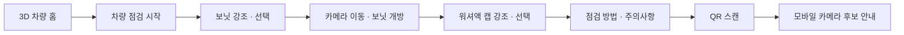
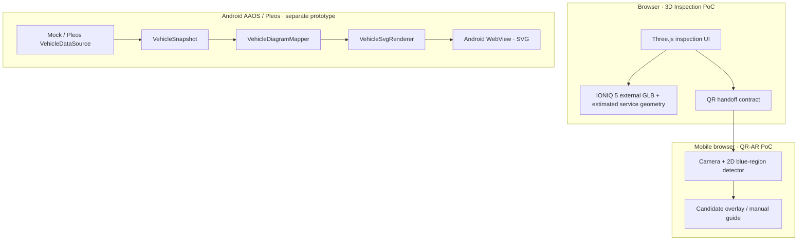

# CarScope

**3D 차량 탐색에서 스마트폰 카메라 안내까지 이어지는 인터랙티브 차량 점검 프로토타입**

CarScope는 차량 전체 모델에서 점검 부위를 찾아 확대하고, 점검 절차를 확인한 뒤 QR로 모바일 카메라 보조 화면에 진입하는 사용자 흐름을 구현합니다. Android Automotive OS(AAOS) 및 Pleos SDK의 **읽기 전용 차량 상태 관측**은 별도 경계에서 검증하고 있습니다.

> **현재 범위:** 브라우저 기반 차량 점검 UX와 모바일 QR-AR PoC의 연결이 구현됐습니다. 이 3D 점검 화면이 Android/Pleos 앱에 통합된 것은 **아직 아닙니다**. 보닛 회전과 부품 위치는 시뮬레이션·추정값이며, QR-AR은 워셔액 주입구를 의미적으로 인식하지 않습니다.

[차량 점검 UI](tools/three-poc/INSPECTION_UI.md) · [QR-AR 검증](tools/mobile-ar-poc/HTTPS_STAGING.md) · [Android/Pleos 연동](docs/pleos-sdk-integration.md) · [개발 로드맵](docs/roadmap.md)

## Preview


*기존 P2-A6 3D 참조 모델 검증 캡처입니다. 최신 P3-A4 점검 UI의 화면 캡처는 아니며, 해당 UI는 `tools/three-poc/inspect.html`에서 실행합니다. 최신 UI 캡처는 로컬 외부 증거 폴더에 보관되어 있어 라이선스·공개 범위 확인 후 추가할 예정입니다.*

<details>
<summary>추가 3D 검증 이미지 보기</summary>

| 부품 선택 검증 | 원본 차량 외피 숨김 검증 |
| --- | --- |
|  |  |

두 이미지는 기존 엔지니어링 PoC의 캡처입니다. 최신 차량 점검 UI와 혼동하지 마세요.

</details>

## Inspection Flow



- **3D 점검 UI (브라우저):** 3D 차량 회전·줌, 보닛 raycast 선택, 카메라 이동, 보닛 개폐 애니메이션, 워셔액 캡 `washer-fluid-cap` 강조, 점검 패널을 제공합니다.
- **모바일 QR-AR (스마트폰 브라우저):** `#v=1&task=washer-fluid` 계약으로 이동해 카메라 영상에서 **파란색 영역 후보**를 2D 바운딩 박스로 표시합니다. 수동 안내와 카메라 중지·재시작을 지원합니다. 영상은 브라우저 내에서 처리하며 업로드하지 않습니다.
- **Android/Pleos (별도 프로토타입):** Mock/Pleos 소스를 분리하고, Pleos SDK에서 읽은 도어 상태를 SVG로 반영합니다. 집 PC의 Pleos AVD에서 도어 이벤트 → SVG 변경을 확인했습니다. **Three.js 점검 UI가 Android 앱에 연결됐다는 뜻은 아닙니다.**

## Features & Status

| 기능 | 현재 범위 | 상태 |
| --- | --- | --- |
| 3D 차량 점검 UX | 차량 홈 → 보닛 → 워셔액 안내 → QR | 브라우저 PoC 구현 |
| 전방 구획 | Shell, 프렁크, 워셔액 주입구 몸체·캡 | 추정 Geometry / 검증된 시뮬레이션 범위 |
| 부품 인터랙션 | 부품 강조, 선택, 근접 카메라, 뒤로 가기, 취소·복원 | 브라우저 회귀 PASS |
| 모바일 카메라 보조 | 색상 후보 오버레이, 수동 안내, 중지·재시작 | Galaxy Z Flip8 사용자 보고 검증 |
| Pleos 연동 | 읽기 전용 ROW_1_LEFT 도어 관측 → Android SVG | Pleos AVD 특정 환경 PASS |
| 기타 전방 점검 부품 | 냉각수·저전도 냉각수·브레이크액·12V 배터리·퓨즈박스 | 예약만 존재 · 실제 형상 미구현 |
| Android 3D 점검 UI | Three.js 점검 UX의 앱 내 실행·통합 | **P3-A5 예정** |

워셔액 캡·프렁크와 보닛의 형상, 회전축 및 좌표는 OEM CAD·실차 실측값이 아닙니다. 모바일의 파란 후보 박스는 실제 주입구의 식별 결과가 아닙니다.

## Architecture



| 영역 | 주요 기술 및 역할 |
| --- | --- |
| 3D 프런트엔드 | JavaScript, Three.js, glTF/GLB, Raycaster, 상태 머신 |
| 모바일 보조 | HTTPS, Web Camera API, Canvas, 2D 색상 후보 탐지, QR |
| Android / 차량 데이터 | Kotlin, Android WebView, Pleos Vehicle SDK 2.3.2 |
| Core | 순수 Kotlin JVM `vehicle-core` · 상태 매핑·SVG 렌더 |
| 품질 검증 | Node 테스트, 브라우저 자동화, Geometry 회귀, GitHub Actions |

## Getting Started

### 1. 차량 점검 UI (로컬 브라우저)

Node.js **22 이상**과, 별도로 권한을 확인하여 준비한 IONIQ 5 GLB가 필요합니다. 커뮤니티 원본 모델·변환 GLB는 저장소에 포함하지 않습니다. 변환 방법은 [IONIQ 5 자산 도구](tools/ioniq5-asset/README.md)를 참고하세요.

```powershell
cd tools/three-poc
npm ci --ignore-scripts

# 사용자가 로컬에서 준비한 외부 모델의 실제 경로로 교체
$env:CARSCOPE_IONIQ5_GLB = 'C:\CarScope-External\ioniq5-carscope\hyundai_ioniq_5_2022.glb'

# 선택 사항: 모바일 QR 스테이징 HTTPS origin
# 미설정이면 QR 단계는 비활성 안내로 표시됩니다.
$env:CARSCOPE_QR_AR_BASE_URL = 'https://carscope-qr-ar-staging.vercel.app/'

$env:PORT = '8098'
npm run serve
```

브라우저에서 [http://127.0.0.1:8098/inspect.html](http://127.0.0.1:8098/inspect.html)을 엽니다. 상기 QR 스테이징은 **Vercel Authentication으로 접근이 제한**되어 있으며 일반 공개 데모가 아닙니다. 별도의 안전한 HTTPS origin을 사용해도 됩니다.

### 2. 테스트

```powershell
# 저장소 루트
node --test tools/three-poc/test/*.test.mjs

cd tools/mobile-ar-poc
npm ci
npm run check
npm test
# Playwright 브라우저 준비가 된 환경에서:
npm run test:browser
```

```powershell
# 저장소 루트 · JDK 17 · Android SDK 없이 coreOnly 검증
.\gradlew.bat -PcoreOnly=true :vehicle-core:test --console=plain
```

전체 브라우저 점검 시나리오는 외부 GLB가 필요한 로컬 검증입니다. GitHub Actions의 합성 fixture 기반 CI 성공을 실차·실기기 E2E 성공으로 해석하지 않습니다. Android 앱 실행은 [개발 환경 가이드](docs/development-setup.md)를 참고하세요.

## Validation

| 검증 대상 | 확인된 결과 | 한계 |
| --- | --- | --- |
| 점검 UI 상태 전이 | Node 단위 테스트 9/9 PASS | 브라우저와 Android 앱은 별도 |
| 점검 UI E2E | 4개 뷰포트에서 각각 17개 assertion PASS | 로컬 브라우저·외부 GLB 기반 |
| QR-AR | Node 16/16, 합성 브라우저 반복 검증 PASS | 실차 의미 인식 정확도 미검증 |
| 모바일 실기기 | Samsung Galaxy Z Flip8 / Android Chrome, 13개 항목 `USER_REPORTED PASS` | OS·Chrome 세부 버전 미기록; 실차 캡 직접 촬영 아님 |
| Pleos SDK | 집 PC Pleos AVD에서 실제 도어 이벤트 → SVG 반영 PASS | 오류 경로·STALE 정책 및 릴리스 검증 잔여 |
| Geometry | 서비스 286행·프렁크 4,148행 표본 검사에서 교차 0 | 연속 회전 전체·OEM 기구 무충돌 증명이 아님 |

근거: [P3-A4 점검 UI](tools/three-poc/INSPECTION_UI.md), [QR-AR 실기기 기록](tools/mobile-ar-poc/HTTPS_STAGING.md), [전방 서비스 Geometry](docs/p3-a2-3-service-components.md), [프렁크 검증](docs/p3-a2-2-frunk-modeling.md), [Pleos SDK 실험](docs/pleos-sdk-integration.md).

## Roadmap

1. **P3-A5 · Android/Pleos 통합:** 현재 브라우저 점검 UI를 Android 디버그 경계에서 검증하고, 기존 SVG 및 Pleos 관측 기능을 보존합니다.
2. **안정성·성능:** Android WebView/WebGL 성능, 수명주기, 액세스 정책, 터치/HMI 동작을 별도 검증합니다.
3. **점검 부위 확장:** 공식 근거와 실제 형상 검증이 가능한 부위부터 순차적으로 추가합니다.
4. **식별 정확도 평가:** 라벨이 있는 실물 이미지와 실제 차량을 확보한 이후 색상 후보 방식의 오탐·미탐을 별도로 평가합니다.

자세한 단계별 기록은 [로드맵](docs/roadmap.md)과 [전체 검증 문서](docs/validation-report.md)에 보존합니다.

## Model, References & Attribution

IONIQ 5 참조 형상은 **현대자동차 공식 CAD가 아닌 커뮤니티 모델**입니다. [OpenX Assets 기반 변환 및 저작권 고지](docs/p2-a6-ioniq5-asset.md)에 따르면 “Hyundai Ioniq 5” © 2022 andikapratamaw (CC BY 4.0), OpenX Assets 수정 © 2026 Dogan Ulus (MPL-2.0 AND CC-BY-4.0)이며, 이 README의 기존 3D 렌더 이미지에도 같은 출처가 적용됩니다. Hyundai의 보증 또는 공식 인증을 의미하지 않습니다.

워셔액 점검 절차와 부품 존재 근거는 [Hyundai UK IONIQ 5 2022 Maintenance PDF](https://manuals.hyundai.co.uk/umanuals/ioniq-5/ioniq-5-2022-maintenance.pdf)를 참조했습니다. 시장별 실제 배치·치수·정비 적용은 사용자 차량 설명서로 다시 확인해야 합니다.

저장소에는 외부 원본 GLB, 파생 고밀도 메시, 실기기 캡처·로그, 인증 토큰 또는 SDK 바이너리를 넣지 않습니다. 이미지·모델 재배포는 각 원출처의 조건을 따릅니다.