# CarScope

**Interactive 3D vehicle inspection, from the car to your phone camera.**

<p align="center">
  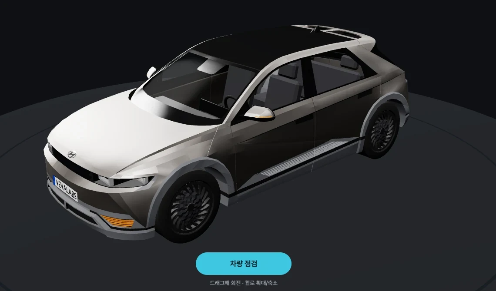
</p>
<p align="center"><sub>P3-A4 차량 점검 UI 홈 화면 (<code>tools/three-poc/inspect.html</code>, 로컬 Chrome 실제 캡처). 차량 모델: “Hyundai Ioniq 5” © 2022 andikapratamaw, <a href="https://creativecommons.org/licenses/by/4.0/">CC BY 4.0</a>. OpenX Assets 수정본을 CarScope에서 변환·렌더링했습니다. <a href="#model-references--attribution">출처 자세히</a></sub></p>

CarScope는 3D 차량에서 부위를 선택하고, 네 타이어의 육안 응답을 기록·확정한 뒤 요약을 검토하는 차량 점검 프로토타입입니다. 워셔액은 기존 안내와 QR 스마트폰 점검으로 이어집니다. 사용자 기록과 Android Automotive OS(AAOS)/Pleos SDK의 **읽기 전용 상태 관측**을 구분합니다.

Debug 점검 화면은 워셔액 경고·브레이크액 레벨과 EV 배터리 SoC·충전 스위치를 [Native 캐시의 제한된 상태 계약](docs/contracts/vehicle-component-ui-v1.md)으로 표시합니다. [EV 하부 보기](docs/p4-b2-ev-status-ui.md)는 기존 추정 외함 모델을 사용하며 API 출처와 형상 신뢰도를 구분합니다. 실차 지원·권한·수신과 SoC 단위·범위는 미검증이고, 충전 스위치는 충전 진행 상태를 뜻하지 않습니다.

> **현재 범위:** 같은 3D 점검 UI를 브라우저와 Android **Debug InspectionActivity**에 패키징합니다. 네 타이어 USER_REPORTED 기록, 전체 요약, Native 워셔액 수신 화면 진입이 구현돼 있습니다. Release의 기본 화면은 기존 정적 SVG이며 Debug 3D/외부 GLB를 포함하지 않습니다. **최신 통합 Android 실측은 별도 최종 검증 단계로 연기**했습니다. 보닛/서비스 부품은 추정·시뮬레이션이고 QR-AR은 실제 주입구를 의미적으로 인식하지 않습니다.

[차량 점검 UI](tools/three-poc/INSPECTION_UI.md) · [제품 흐름·보존 정책 설계](docs/p4-a1-inspection-product-flow.md) · [QR-AR 검증](tools/mobile-ar-poc/HTTPS_STAGING.md) · [Android/Pleos 연동](docs/pleos-sdk-integration.md) · [개발 로드맵](docs/roadmap.md)

## Product Gallery

**차량에서 부위를 이해하고, 모바일에서 보이는 내용을 직접 기록합니다.** 아래는 기존 구현을 실행한 Chrome 캡처입니다. 상태 패널은 MOCK fixture, 모바일 카메라는 합성 영상이며 실차 센서 수신·실제 스마트폰 촬영의 증거가 아닙니다. 이미지를 누르면 크게 볼 수 있습니다.

| 보닛을 열어 점검 부위 탐색 | 네 타이어의 개별 육안 기록 |
| --- | --- |
| [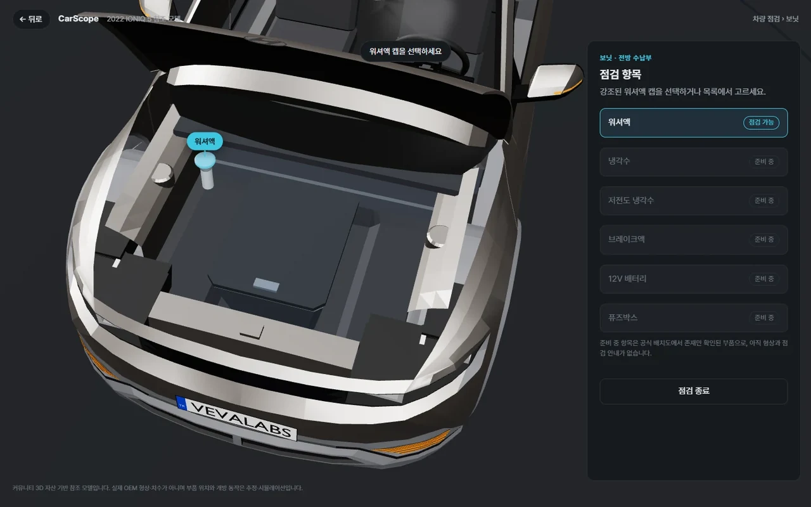](docs/visuals/readme/hood-open.webp) | [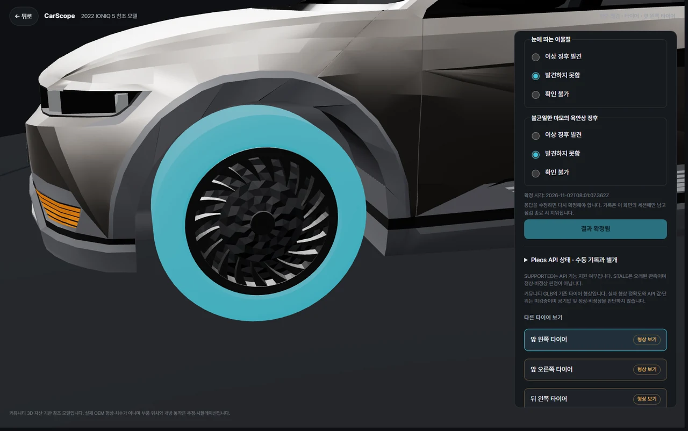](docs/visuals/readme/tire-inspection.webp) |
| 추정 전방 구획과 워셔액 위치 안내. 실제 OEM 힌지·정비 절차를 재현한 형상은 아닙니다. | 바퀴별 응답 → 확정·수정 → 요약. **USER_REPORTED**, 정상·안전 판정이 아닙니다. |

| EV 충전구 선택과 상태 분리 | 전면 와이퍼 선택과 상태 표시 |
| --- | --- |
| [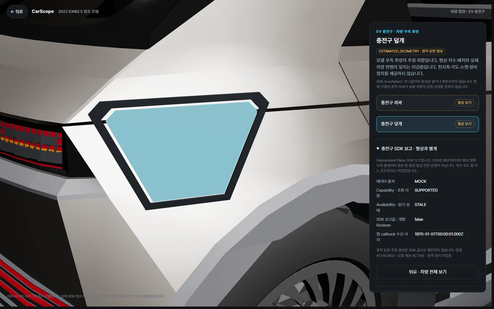](docs/visuals/readme/charge-port.webp) | [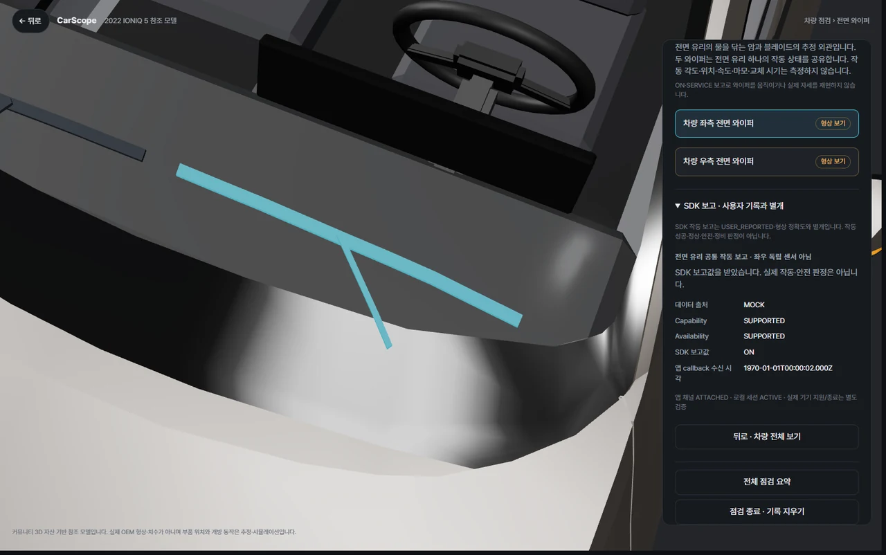](docs/visuals/readme/wiper-selection.webp) |
| 정적 닫힘 형상과 SDK 보고를 분리합니다. 충전구 위치·개방 각도·충전 가능 여부의 실측 증거가 아닙니다. | 선택·강조된 와이퍼는 정적 추정 형상입니다. 동작 상태를 블레이드 마모 판정으로 해석하지 않습니다. |

| 전조등 영역 선택과 전역 상태 | 모바일 카메라 보조와 결과 확정 |
| --- | --- |
| [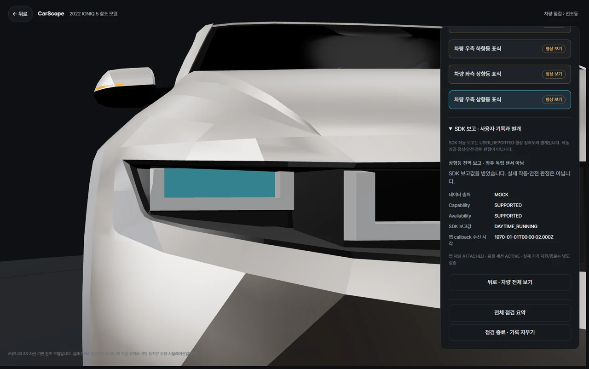](docs/visuals/readme/headlight-selection.webp) | [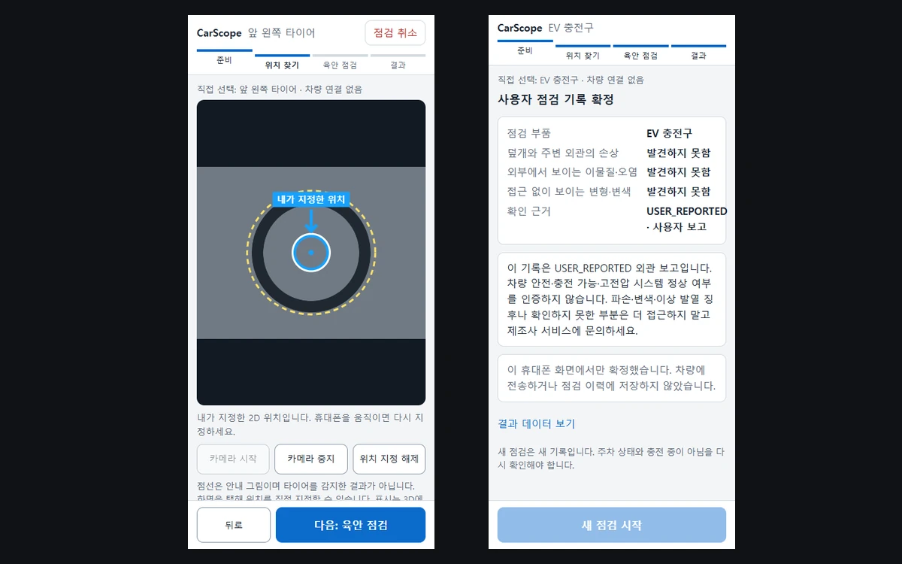](docs/visuals/readme/mobile-assistance.webp) |
| 기존 조명 메시를 재사용합니다. 전역 조명 보고는 좌·우 개별 센서값이나 실제 점등 효과가 아닙니다. | 기존 모바일 캡처 2장의 편집본. **수동 2D 표시**, 자동 객체 인식·공간 추적·정밀 측정은 없습니다. |

3D 이미지: “Hyundai Ioniq 5” © 2022 [andikapratamaw](https://sketchfab.com/andikapratamaw), [CC BY 4.0](https://creativecommons.org/licenses/by/4.0/); OpenX Assets 수정 © 2026 Dogan Ulus. CarScope 변환·추정 Geometry·UI 렌더링, README용 축소·WebP 변환. [이미지별 출처·변환·검토 기록](docs/visuals/readme/README.md).

구현·검증 근거: [충전구 3D](docs/p4-b3-charge-port-ui.md) · [와이퍼·조명](docs/p5-b1-vehicle-api-integration.md) · [타이어 모바일](docs/p5-a1-tire-mobile-ar.md) · [충전구 모바일](docs/p5-a2-charge-port-mobile-ar.md). 모바일 Node 동기화와 실제 Android Native 수신·실기기 검증은 해당 문서의 범위를 구분합니다.

## Features

| 기능 | 구현 범위 | 상태 |
| --- | --- | --- |
| **Interactive 3D Vehicle Inspection** | 홈 → 부위 선택 → 상세 → 전체 요약 → 종료. 모델 회전·확대/축소, 취소·뒤로 가기·중복 입력 처리 | 브라우저 / Android Debug 패키징 |
| **Hood Opening Animation** | 보닛 선택 시 카메라가 전방으로 이동하고 보닛이 0→60° 열림. 전방 구획 Shell·프렁크(닫힘) 노출. 중간 취소 시 현재 각도에서 닫힘 | 시뮬레이션 축 A 기준 · 실제 힌지 미검증 |
| **Component Highlight & Navigation** | 워셔액 캡 강조·라벨·근접 카메라, 냉각수/브레이크액/12V/퓨즈박스 preview, 네 타이어 Raycast·고무 강조 | 기존 검증 형상 재사용 · 저전도 냉각수 준비 중 |
| **Four-tire Self Inspection** | 타이어별 3응답, 명시 확정, 수정·재확정, 이전/다음, 부분/전체 요약 | USER_REPORTED · 정상/안전 판정 아님 |
| **Session Summary & Exit** | 타이어 기록과 워셔액 결과 미수집 범위를 구분. 모든 활성 화면에 전체 요약/종료 제공 | 메모리 전용 · 홈/종료/닫기/새로고침 시 삭제 |
| **Washer Fluid Inspection Guide** | 점검 방법, 주의사항, Hyundai 공식 정비 설명서 출처 | 구현 · 위치·형상은 추정 |
| **QR-to-Mobile Camera Assistance** | `#v=1&task=washer-fluid` QR과 직접 링크. 스마트폰 카메라에서 파란색 영역 후보를 2D 박스로 표시하고 수동 안내 제공. 영상은 기기 안에서만 처리 | Galaxy Z Flip8 Android Chrome 사용자 보고 PASS · 의미 인식 미검증 |
| **Pleos SDK Vehicle Data** | 기존 도어→SVG와 별도로 Debug 3D 타이어 상세에 cache 기반 capability/availability/source/observedAt 표시 | 상태 전용 · 압력/단위 미제공 · 최신 실제 Tire Runtime 미검증 |
| **Android Debug Navigation** | 시스템 Back과 웹 단계 Back 공유, 외부 링크 차단 안내, 기존 Native 워셔액 Receiver 진입 | JVM/Robolectric 범위와 실제 Android 실측 구분 |

냉각수·브레이크액·12V 배터리·퓨즈박스는 추정 형상 탐색만 지원하며 점검 절차는 제공하지 않습니다. 저전도 냉각수는 준비 중입니다. 모델과 형상·회전축·좌표는 OEM CAD나 실차 실측값이 아닙니다. 점검 완료는 응답 확정이며 차량 정상·안전·주행 가능 판정이 아닙니다.

## User Flow

차량 홈 → 차량 점검 → 3D 부위 선택 → 점검 상세 → 전체 점검 요약 → 계속 점검 / 종료·기록 지우기

- **타이어:** 네 바퀴 선택 → 육안 응답 3개 → 결과 확정 → 수정·재확정 / 타이어 전환 → 요약.
- **워셔액:** 보닛 → 워셔액 안내 → 선택적 QR → 모바일 보조. QR 열람을 점검 완료로 집계하지 않습니다. 모바일/Native 수신 결과는 3D 기록과 별도입니다.
- **보존:** 같은 페이지 안에서 이동하면 기록을 유지합니다. 영구 저장·reload/Activity 재생성 복구는 구현하지 않습니다. [저장·복원·삭제 후속 요구사항](docs/p4-a1-inspection-product-flow.md)을 먼저 확정합니다.

<details>
<summary>초기 P3-A4 워셔액 흐름 캡처 — 현재 추가된 타이어·요약 화면과 구분</summary>

| ① 차량 점검 · 보닛 강조 | ② 보닛 개방 · 점검 항목 |
| --- | --- |
| <a href="docs/visuals/p3-a4/flow-1-hood-highlight.webp">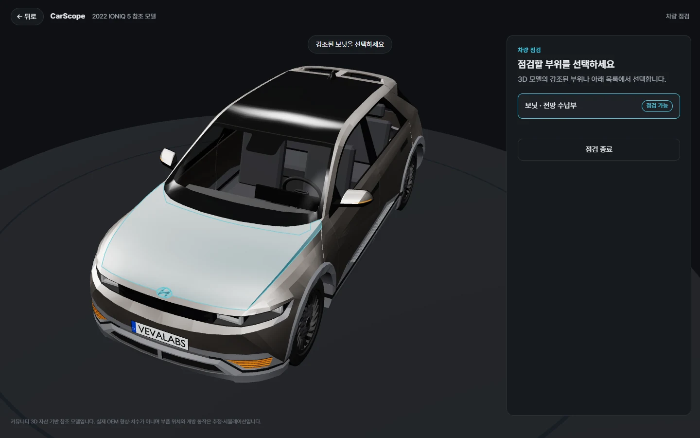</a> | <a href="docs/visuals/p3-a4/flow-2-hood-open-components.webp"></a> |
| 강조된 보닛을 3D에서 누르거나 목록에서 선택합니다. | 카메라가 전방으로 이동하고 보닛이 열립니다. 워셔액 캡만 선택할 수 있습니다. |

| ③ 워셔액 점검 상세 | ④ 스마트폰 연결 QR |
| --- | --- |
| <a href="docs/visuals/p3-a4/flow-3-washer-detail.webp">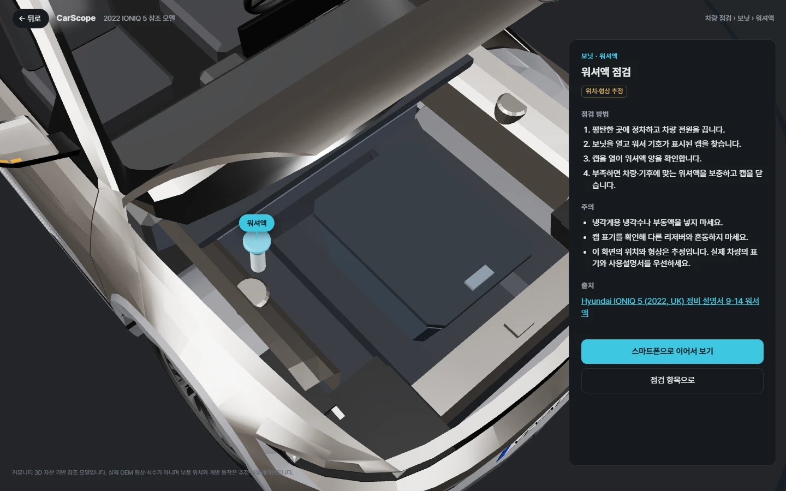</a> | <a href="docs/visuals/p3-a4/flow-4-qr-handoff.webp"></a> |
| 근접 카메라와 함께 점검 방법·주의사항·출처를 표시합니다. | QR을 스캔하면 모바일 카메라 보조 화면이 열립니다. |

위 4장은 1440×900 로컬 Chrome에서 `inspect.html`을 실제로 실행해 캡처했습니다(2026-11-01, main `062b6b2`와 같은 UI 코드). ③·④는 같은 화면의 일부를 잘라낸 것입니다. QR은 접근이 제한된 스테이징 주소를 가리킵니다. 마지막 모바일 보조 단계는 사용자가 실제 스마트폰에서 확인했지만 공개 가능한 실기기 화면 캡처가 없어 이미지를 넣지 않았습니다.

</details>

<details>
<summary>이전 단계의 엔지니어링 검증 이미지 (P2-A6)</summary>

| 3D 참조 모델 | 부품 선택 검증 | 외피 숨김 검증 |
| --- | --- | --- |
| 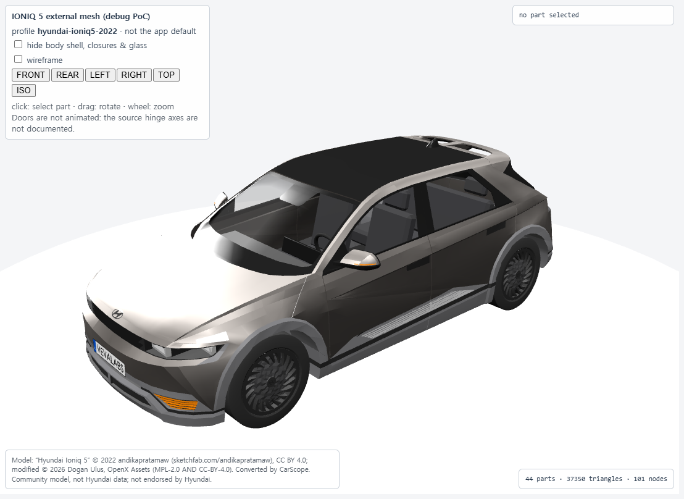 | 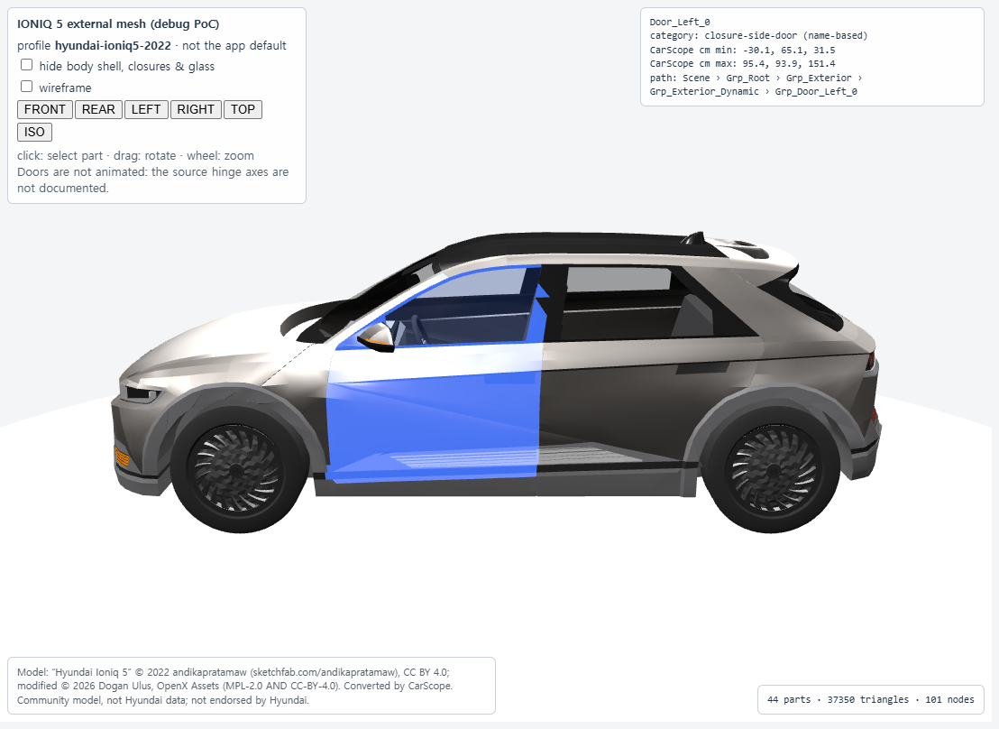 | 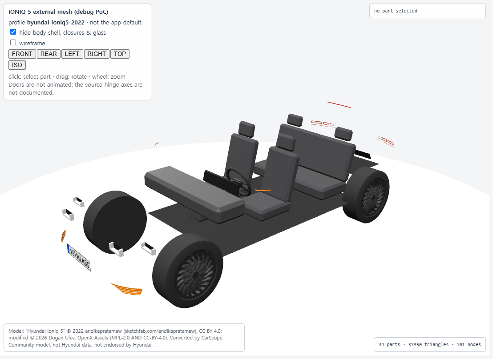 |

P2-A6 엔지니어링 PoC 캡처이며 현재 차량 점검 UI 화면이 아닙니다.

</details>

## Architecture

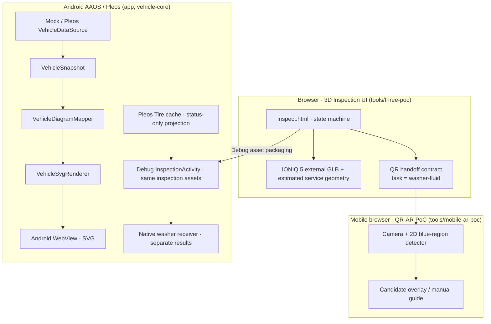

브라우저와 Debug WebView는 같은 점검 자산/상태 머신을 사용합니다. Debug의 Native 버튼이 별도 수신 Activity를 엽니다. JS가 Native Sync를 제어하거나 모바일 결과를 타이어 기록으로 병합하지 않습니다. Release 기본 SVG와 Debug 3D의 포함 범위는 구분하며 실제 Tire SDK 수신·WebView 수명주기 성공은 패키징/CI만으로 주장하지 않습니다.

| 영역 | 주요 기술 및 역할 |
| --- | --- |
| 3D 프런트엔드 | JavaScript, Three.js, glTF/GLB, Raycaster, 상태 머신 |
| 모바일 보조 | HTTPS, Web Camera API, Canvas, 2D 색상 후보 탐지, QR |
| Android / 차량 데이터 | Kotlin, Android WebView, Pleos Vehicle SDK 2.3.2 |
| Core | 순수 Kotlin JVM `vehicle-core` · 상태 매핑·SVG 렌더 |
| 품질 검증 | Node 테스트, 브라우저 자동화, Geometry 회귀, GitHub Actions |

## Getting Started

### 1. 차량 점검 UI (로컬 브라우저)

Node.js **22 이상**과, 별도로 권한을 확인하여 준비한 IONIQ 5 GLB가 필요합니다. 커뮤니티 원본 모델·변환 GLB는 저장소에 포함하지 않습니다. 변환 방법은 [IONIQ 5 자산 도구](tools/ioniq5-asset/README.md)를 참고하세요.

```powershell
cd tools/three-poc
npm ci --ignore-scripts

# 사용자가 로컬에서 준비한 외부 모델의 실제 경로로 교체
$env:CARSCOPE_IONIQ5_GLB = 'C:\CarScope-External\ioniq5-carscope\hyundai_ioniq_5_2022.glb'

# 선택 사항: 모바일 QR 스테이징 HTTPS origin
# 미설정이면 QR 단계는 비활성 안내로 표시됩니다.
$env:CARSCOPE_QR_AR_BASE_URL = 'https://carscope-qr-ar-staging.vercel.app/'

$env:PORT = '8098'
npm run serve
```

브라우저에서 [http://127.0.0.1:8098/inspect.html](http://127.0.0.1:8098/inspect.html)을 엽니다. 상기 QR 스테이징은 **Vercel Authentication으로 접근이 제한**되어 있으며 일반 공개 데모가 아닙니다. 별도의 안전한 HTTPS origin을 사용해도 됩니다.

### 2. 테스트

```powershell
# 저장소 루트
node --test tools/three-poc/test/*.test.mjs

cd tools/mobile-ar-poc
npm ci
npm run check
npm test
# Playwright 브라우저 준비가 된 환경에서:
npm run test:browser
```

```powershell
# 저장소 루트 · JDK 17 · Android SDK 없이 coreOnly 검증
.\gradlew.bat -PcoreOnly=true :vehicle-core:test --console=plain
```

전체 브라우저 점검 시나리오는 외부 GLB가 필요한 로컬 검증입니다. GitHub Actions의 합성 fixture 기반 CI 성공을 실차·실기기 E2E 성공으로 해석하지 않습니다. Android 앱 실행은 [개발 환경 가이드](docs/development-setup.md)를 참고하세요.

## Validation

| 검증 대상 | 확인된 결과 | 한계 |
| --- | --- | --- |
| 점검 UI 상태 전이·기록·수신 계약 | Node 회귀와 Android 자산 byte 계약 | 최신 수치는 [P4-A1 보고서](docs/p4-a1-inspection-product-flow.md) |
| 점검 UI E2E | 실제 외부 GLB 기반 Chrome 입력/렌더·회귀 | Android shell JS의 desktop 검사는 실제 Android 아님 |
| Android Debug | JVM/Robolectric, Debug/Release 빌드·격리 | 최신 실제 WebView/SDK/AVD는 최종 통합 단계까지 NOT_RUN |
| QR-AR | Node 16/16, 합성 브라우저 반복 검증 PASS | 실차 의미 인식 정확도 미검증 |
| 모바일 실기기 | Samsung Galaxy Z Flip8 / Android Chrome, 13개 항목 `USER_REPORTED PASS` | OS·Chrome 세부 버전 미기록; 실차 캡 직접 촬영 아님 |
| Pleos SDK | 집 PC Pleos AVD에서 실제 도어 이벤트 → SVG 반영 PASS | 오류 경로·STALE 정책 및 릴리스 검증 잔여 |
| Geometry | 서비스 286행·프렁크 4,148행 표본 검사에서 교차 0 | 연속 회전 전체·OEM 기구 무충돌 증명이 아님 |

근거: [P3-A4 점검 UI](tools/three-poc/INSPECTION_UI.md), [QR-AR 실기기 기록](tools/mobile-ar-poc/HTTPS_STAGING.md), [전방 서비스 Geometry](docs/p3-a2-3-service-components.md), [프렁크 검증](docs/p3-a2-2-frunk-modeling.md), [Pleos SDK 실험](docs/pleos-sdk-integration.md).

## Roadmap

| 완료 | 다음 단계 |
| --- | --- |
| 3D Debug 통합·네 타이어 점검·상태 projection·Native 수신 진입 및 PR #40 기반 | **제품 흐름 정리 → 별도 환경 안정화 후 최종 Android 실측** |

1. **제품 흐름·기록:** 전체 요약·명시적 종료를 연결하고, 로컬 보존/복원/삭제 정책 확정 후 저장 기능을 별도 구현합니다.
2. **안정성·성능:** Android WebView/WebGL 성능, 수명주기, 액세스 정책, 터치/HMI 동작을 별도 검증합니다.
3. **점검 부위 확장:** 공식 근거와 실제 형상 검증이 가능한 부위부터 순차적으로 추가합니다.
4. **식별 정확도 평가:** 라벨이 있는 실물 이미지와 실제 차량을 확보한 이후 색상 후보 방식의 오탐·미탐을 별도로 평가합니다.

자세한 단계별 기록은 [로드맵](docs/roadmap.md)과 [전체 검증 문서](docs/validation-report.md)에 보존합니다.

## Model, References & Attribution

IONIQ 5 참조 형상은 **현대자동차 공식 CAD가 아닌 커뮤니티 모델**입니다.

- 원본 모델: “Hyundai Ioniq 5” © 2022 [andikapratamaw](https://sketchfab.com/andikapratamaw), [CC BY 4.0](https://creativecommons.org/licenses/by/4.0/)
- 수정본: [OpenX Assets](https://github.com/vevalabs/openx-assets) © 2026 Dogan Ulus, `MPL-2.0 AND CC-BY-4.0`
- 변경 사항: CarScope가 형식을 변환하고(`.blend` → GLB), 점검 UI에서 렌더링했습니다. 보닛 회전, 전방 구획·프렁크·워셔액 주입구 형상(CarScope 추정 Geometry), 강조·라벨·UI 패널을 더했습니다.
- 적용 이미지: `docs/visuals/p3-a4/`의 점검 UI 캡처 5장과 `docs/visuals/p2-a6/`의 렌더 3장, `docs/visuals/readme/`의 3D 렌더 캡처 6장(Hero 포함). 이 이미지를 재사용할 때도 위 저작자 표시와 라이선스 링크를 함께 표시해야 합니다. 새 모바일 편집본은 별도의 CarScope UI·합성 영상 캡처이며 3D 모델을 포함하지 않습니다.

자세한 출처와 커밋 정책은 [IONIQ 5 자산 문서](docs/p2-a6-ioniq5-asset.md)에 있습니다. CarScope는 Hyundai와 관련이 없으며, 이 자료는 Hyundai의 보증이나 공식 인증을 뜻하지 않습니다. 차량 디자인과 상표는 각 권리자에게 있습니다.

워셔액 점검 절차와 부품 존재 근거는 [Hyundai UK IONIQ 5 2022 Maintenance PDF](https://manuals.hyundai.co.uk/umanuals/ioniq-5/ioniq-5-2022-maintenance.pdf)를 참조했습니다. 시장별 실제 배치·치수·정비 방법은 사용자 차량의 설명서로 다시 확인해야 합니다.

저장소에는 외부 원본 GLB, Blender 원본, 파생 고밀도 메시, 실기기 캡처·로그, 인증 토큰, SDK 바이너리를 넣지 않습니다.
