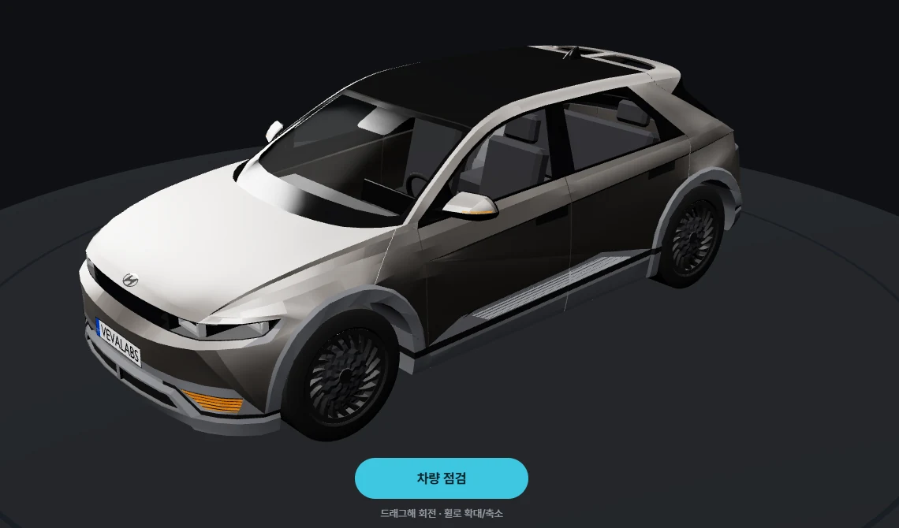
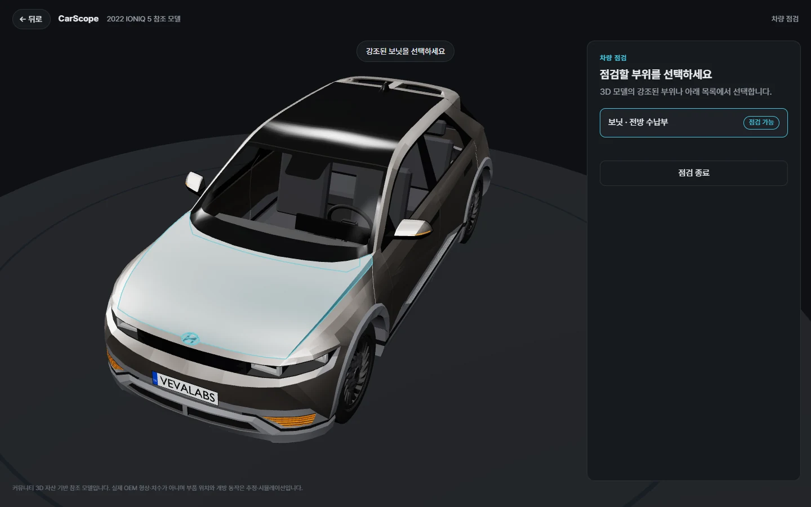
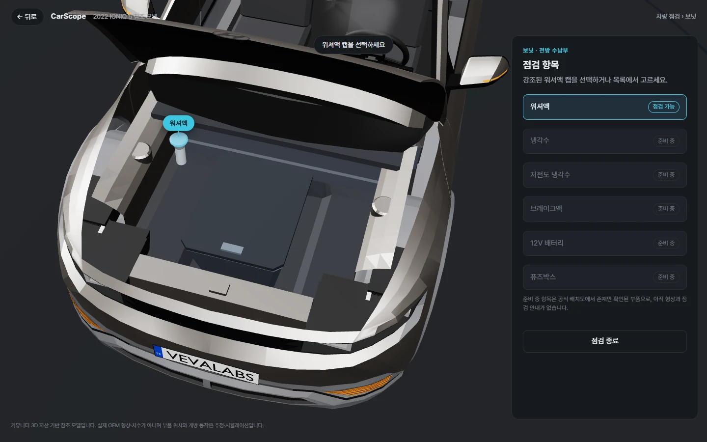
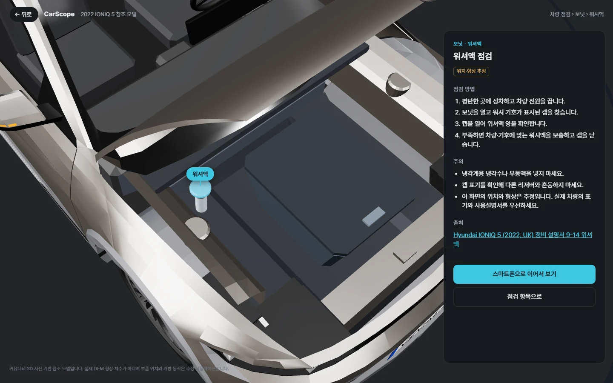
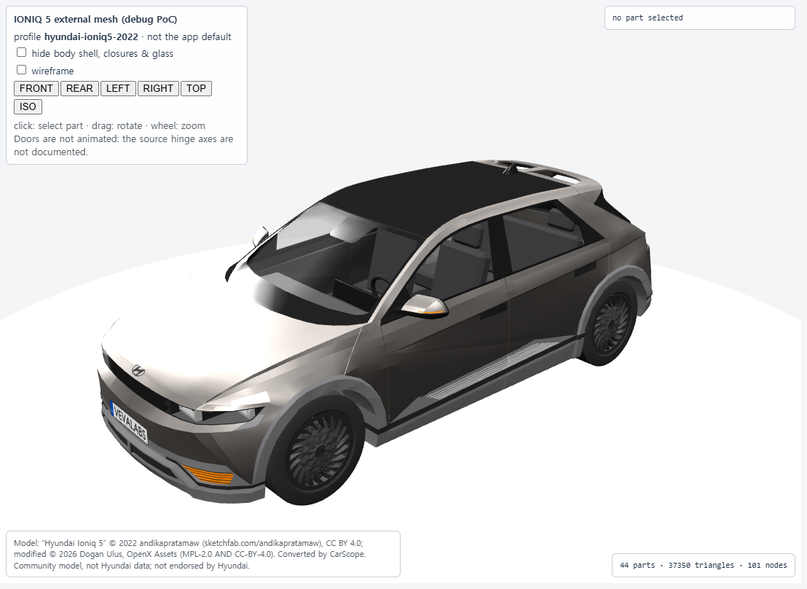
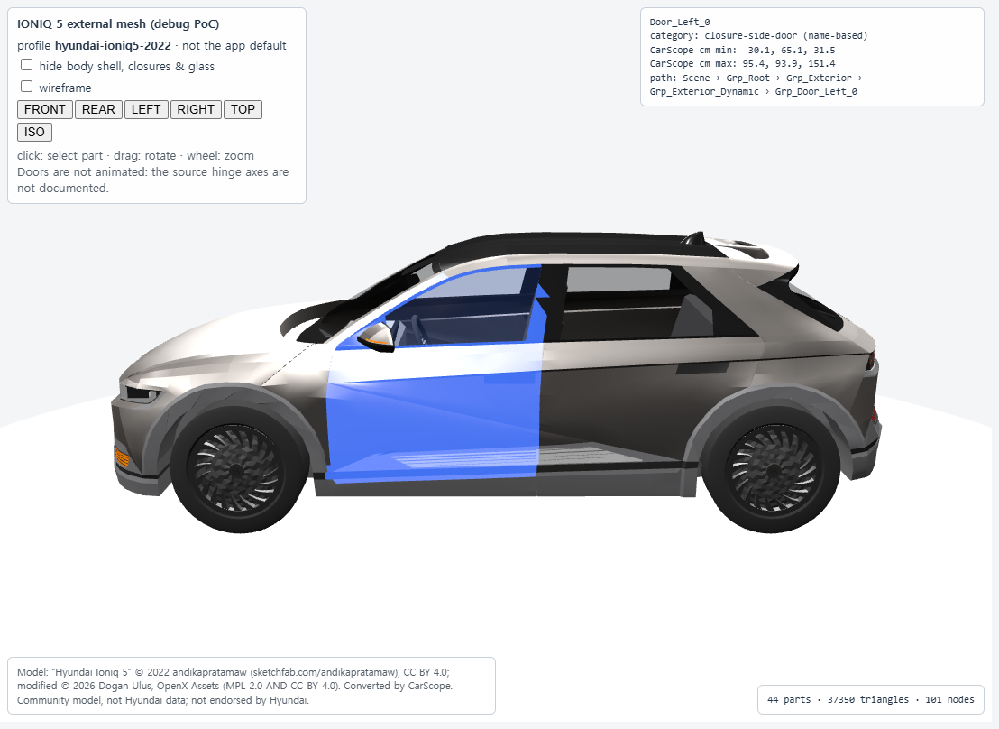
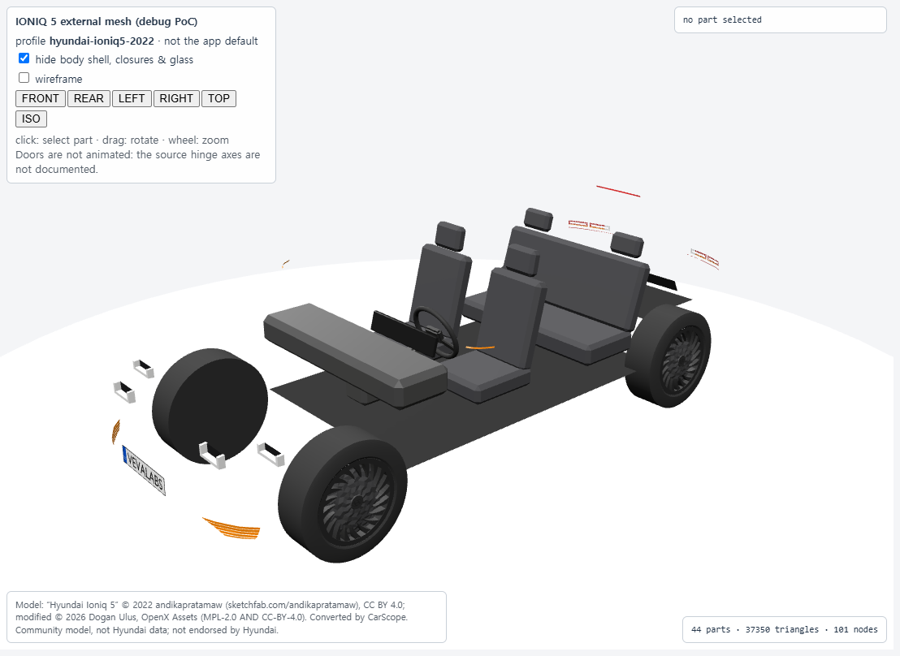
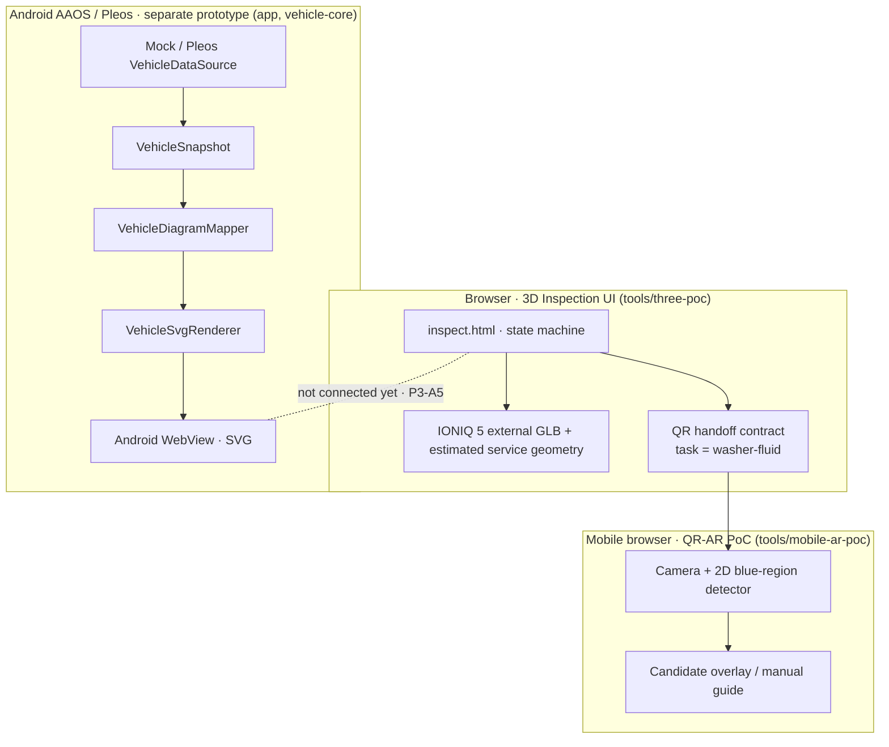

# CarScope

**Interactive 3D vehicle inspection, from the car to your phone camera.**

CarScope는 3D 차량 모델에서 점검할 부위를 찾아 열어 보고, 점검 방법을 확인한 뒤 QR로 스마트폰 카메라 보조 화면까지 이어지는 차량 점검 경험을 만드는 프로젝트입니다. Android Automotive OS(AAOS)와 Pleos SDK의 **읽기 전용 차량 상태 관측**은 별도 프로토타입에서 검증하고 있습니다.

<p align="center">
  
</p>
<p align="center"><sub>P3-A4 차량 점검 UI 홈 화면 (<code>tools/three-poc/inspect.html</code>, 로컬 Chrome 실제 캡처). 차량 모델: “Hyundai Ioniq 5” © 2022 andikapratamaw, <a href="https://creativecommons.org/licenses/by/4.0/">CC BY 4.0</a>. OpenX Assets 수정본을 CarScope에서 변환·렌더링했습니다. <a href="#model-references--attribution">출처 자세히</a></sub></p>

> **현재 범위:** 브라우저 기반 차량 점검 UI와 모바일 QR-AR PoC가 연결됐습니다. 이 3D 점검 화면은 Android/Pleos 앱에 **아직 통합되지 않았습니다**(P3-A5 예정). 보닛 회전과 부품 위치는 시뮬레이션·추정값이고, QR-AR은 워셔액 주입구를 의미적으로 인식하지 않습니다.

[차량 점검 UI](tools/three-poc/INSPECTION_UI.md) · [QR-AR 검증](tools/mobile-ar-poc/HTTPS_STAGING.md) · [Android/Pleos 연동](docs/pleos-sdk-integration.md) · [개발 로드맵](docs/roadmap.md)

## Features

| 기능 | 구현 범위 | 상태 |
| --- | --- | --- |
| **Interactive 3D Vehicle Inspection** | 차량 회전·확대/축소, 차량 점검 모드, 상태 머신 기반 단계 이동과 뒤로 가기·점검 종료 | 브라우저 PoC 구현 |
| **Hood Opening Animation** | 보닛 선택 시 카메라가 전방으로 이동하고 보닛이 0→60° 열림. 전방 구획 Shell·프렁크(닫힘) 노출. 중간 취소 시 현재 각도에서 닫힘 | 시뮬레이션 축 A 기준 · 실제 힌지 미검증 |
| **Component Highlight & Navigation** | 보닛 강조 → 워셔액 캡 `washer-fluid-cap` 강조·라벨·근접 카메라. 3D 클릭과 목록 선택 모두 지원 | 구현 · 다른 5개 부품은 “준비 중”(선택 불가) |
| **Washer Fluid Inspection Guide** | 점검 방법, 주의사항, Hyundai 공식 정비 설명서 출처 | 구현 · 위치·형상은 추정 |
| **QR-to-Mobile Camera Assistance** | `#v=1&task=washer-fluid` QR과 직접 링크. 스마트폰 카메라에서 파란색 영역 후보를 2D 박스로 표시하고 수동 안내 제공. 영상은 기기 안에서만 처리 | Galaxy Z Flip8 Android Chrome 사용자 보고 PASS · 의미 인식 미검증 |
| **Pleos SDK Vehicle Data** | Pleos SDK에서 1열 좌측(`ROW_1_LEFT`) 도어 상태를 읽기 전용으로 관측해 Android SVG 차량도에 반영 | Pleos AVD 특정 환경 PASS · 3D UI와 미연결 |

냉각수·저전도 냉각수·브레이크액·12V 배터리·퓨즈박스는 공식 배치도에서 존재만 확인한 예약 영역이며 실제 형상과 점검 안내가 없습니다. 보닛·프렁크·워셔액 캡의 형상과 회전축·좌표는 OEM CAD나 실차 실측값이 아닙니다.

## User Flow

차량 홈 → 차량 점검 → 보닛 선택 → 보닛 개방 → 워셔액 캡 → QR → 모바일 보조

| ① 차량 점검 · 보닛 강조 | ② 보닛 개방 · 점검 항목 |
| --- | --- |
| <a href="docs/visuals/p3-a4/flow-1-hood-highlight.webp"></a> | <a href="docs/visuals/p3-a4/flow-2-hood-open-components.webp"></a> |
| 강조된 보닛을 3D에서 누르거나 목록에서 선택합니다. | 카메라가 전방으로 이동하고 보닛이 열립니다. 워셔액 캡만 선택할 수 있습니다. |

| ③ 워셔액 점검 상세 | ④ 스마트폰 연결 QR |
| --- | --- |
| <a href="docs/visuals/p3-a4/flow-3-washer-detail.webp"></a> | <a href="docs/visuals/p3-a4/flow-4-qr-handoff.webp"></a> |
| 근접 카메라와 함께 점검 방법·주의사항·출처를 표시합니다. | QR을 스캔하면 모바일 카메라 보조 화면이 열립니다. |

위 4장은 1440×900 로컬 Chrome에서 `inspect.html`을 실제로 실행해 캡처했습니다(2026-11-01, main `062b6b2`와 같은 UI 코드). QR은 접근이 제한된 스테이징 주소를 가리킵니다. 마지막 모바일 보조 단계는 사용자가 실제 스마트폰에서 확인했지만 공개 가능한 실기기 화면 캡처가 없어 이미지를 넣지 않았습니다.

<details>
<summary>이전 단계의 엔지니어링 검증 이미지 (P2-A6)</summary>

| 3D 참조 모델 | 부품 선택 검증 | 외피 숨김 검증 |
| --- | --- | --- |
|  |  |  |

P2-A6 엔지니어링 PoC 캡처이며 현재 차량 점검 UI 화면이 아닙니다.

</details>

## Architecture



브라우저 점검 UI와 Android/Pleos 앱은 **아직 별개의 구현**입니다. 점선은 P3-A5에서 연결할 예정인 경계이며 현재 데이터 흐름이 없습니다. 3D 점검 UI는 Pleos 차량 데이터를 읽지 않고, Android 앱은 3D 점검 UI를 실행하지 않습니다.

| 영역 | 주요 기술 및 역할 |
| --- | --- |
| 3D 프런트엔드 | JavaScript, Three.js, glTF/GLB, Raycaster, 상태 머신 |
| 모바일 보조 | HTTPS, Web Camera API, Canvas, 2D 색상 후보 탐지, QR |
| Android / 차량 데이터 | Kotlin, Android WebView, Pleos Vehicle SDK 2.3.2 |
| Core | 순수 Kotlin JVM `vehicle-core` · 상태 매핑·SVG 렌더 |
| 품질 검증 | Node 테스트, 브라우저 자동화, Geometry 회귀, GitHub Actions |

## Getting Started

### 1. 차량 점검 UI (로컬 브라우저)

Node.js **22 이상**과, 별도로 권한을 확인하여 준비한 IONIQ 5 GLB가 필요합니다. 커뮤니티 원본 모델·변환 GLB는 저장소에 포함하지 않습니다. 변환 방법은 [IONIQ 5 자산 도구](tools/ioniq5-asset/README.md)를 참고하세요.

```powershell
cd tools/three-poc
npm ci --ignore-scripts

# 사용자가 로컬에서 준비한 외부 모델의 실제 경로로 교체
$env:CARSCOPE_IONIQ5_GLB = 'C:\CarScope-External\ioniq5-carscope\hyundai_ioniq_5_2022.glb'

# 선택 사항: 모바일 QR 스테이징 HTTPS origin
# 미설정이면 QR 단계는 비활성 안내로 표시됩니다.
$env:CARSCOPE_QR_AR_BASE_URL = 'https://carscope-qr-ar-staging.vercel.app/'

$env:PORT = '8098'
npm run serve
```

브라우저에서 [http://127.0.0.1:8098/inspect.html](http://127.0.0.1:8098/inspect.html)을 엽니다. 상기 QR 스테이징은 **Vercel Authentication으로 접근이 제한**되어 있으며 일반 공개 데모가 아닙니다. 별도의 안전한 HTTPS origin을 사용해도 됩니다.

### 2. 테스트

```powershell
# 저장소 루트
node --test tools/three-poc/test/*.test.mjs

cd tools/mobile-ar-poc
npm ci
npm run check
npm test
# Playwright 브라우저 준비가 된 환경에서:
npm run test:browser
```

```powershell
# 저장소 루트 · JDK 17 · Android SDK 없이 coreOnly 검증
.\gradlew.bat -PcoreOnly=true :vehicle-core:test --console=plain
```

전체 브라우저 점검 시나리오는 외부 GLB가 필요한 로컬 검증입니다. GitHub Actions의 합성 fixture 기반 CI 성공을 실차·실기기 E2E 성공으로 해석하지 않습니다. Android 앱 실행은 [개발 환경 가이드](docs/development-setup.md)를 참고하세요.

## Validation

| 검증 대상 | 확인된 결과 | 한계 |
| --- | --- | --- |
| 점검 UI 상태 전이 | Node 단위 테스트 9/9 PASS | 브라우저와 Android 앱은 별도 |
| 점검 UI E2E | 4개 뷰포트에서 각각 17개 assertion PASS | 로컬 브라우저·외부 GLB 기반 |
| QR-AR | Node 16/16, 합성 브라우저 반복 검증 PASS | 실차 의미 인식 정확도 미검증 |
| 모바일 실기기 | Samsung Galaxy Z Flip8 / Android Chrome, 13개 항목 `USER_REPORTED PASS` | OS·Chrome 세부 버전 미기록; 실차 캡 직접 촬영 아님 |
| Pleos SDK | 집 PC Pleos AVD에서 실제 도어 이벤트 → SVG 반영 PASS | 오류 경로·STALE 정책 및 릴리스 검증 잔여 |
| Geometry | 서비스 286행·프렁크 4,148행 표본 검사에서 교차 0 | 연속 회전 전체·OEM 기구 무충돌 증명이 아님 |

근거: [P3-A4 점검 UI](tools/three-poc/INSPECTION_UI.md), [QR-AR 실기기 기록](tools/mobile-ar-poc/HTTPS_STAGING.md), [전방 서비스 Geometry](docs/p3-a2-3-service-components.md), [프렁크 검증](docs/p3-a2-2-frunk-modeling.md), [Pleos SDK 실험](docs/pleos-sdk-integration.md).

## Roadmap

| 완료 | 다음 단계 |
| --- | --- |
| P3-A4 차량 점검 UI (PR #21) · QR-AR 모바일 보조 (PR #18) | **P3-A5 · Android/Pleos UI 통합** |

1. **P3-A5 · Android/Pleos 통합 (다음 단계):** 현재 브라우저 점검 UI를 Android 디버그 경계에서 검증하고, 기존 SVG 및 Pleos 관측 기능을 보존합니다.
2. **안정성·성능:** Android WebView/WebGL 성능, 수명주기, 액세스 정책, 터치/HMI 동작을 별도 검증합니다.
3. **점검 부위 확장:** 공식 근거와 실제 형상 검증이 가능한 부위부터 순차적으로 추가합니다.
4. **식별 정확도 평가:** 라벨이 있는 실물 이미지와 실제 차량을 확보한 이후 색상 후보 방식의 오탐·미탐을 별도로 평가합니다.

자세한 단계별 기록은 [로드맵](docs/roadmap.md)과 [전체 검증 문서](docs/validation-report.md)에 보존합니다.

## Model, References & Attribution

IONIQ 5 참조 형상은 **현대자동차 공식 CAD가 아닌 커뮤니티 모델**입니다.

- 원본 모델: “Hyundai Ioniq 5” © 2022 [andikapratamaw](https://sketchfab.com/andikapratamaw), [CC BY 4.0](https://creativecommons.org/licenses/by/4.0/)
- 수정본: [OpenX Assets](https://github.com/vevalabs/openx-assets) © 2026 Dogan Ulus, `MPL-2.0 AND CC-BY-4.0`
- 변경 사항: CarScope가 형식을 변환하고(`.blend` → GLB), 점검 UI에서 렌더링했습니다. 보닛 회전, 전방 구획·프렁크·워셔액 주입구 형상(CarScope 추정 Geometry), 강조·라벨·UI 패널을 더했습니다.
- 적용 이미지: `docs/visuals/p3-a4/`의 점검 UI 캡처 5장과 `docs/visuals/p2-a6/`의 렌더 3장. 이 이미지를 재사용할 때도 위 저작자 표시와 라이선스 링크를 함께 표시해야 합니다.

자세한 출처와 커밋 정책은 [IONIQ 5 자산 문서](docs/p2-a6-ioniq5-asset.md)에 있습니다. CarScope는 Hyundai와 관련이 없으며, 이 자료는 Hyundai의 보증이나 공식 인증을 뜻하지 않습니다. 차량 디자인과 상표는 각 권리자에게 있습니다.

워셔액 점검 절차와 부품 존재 근거는 [Hyundai UK IONIQ 5 2022 Maintenance PDF](https://manuals.hyundai.co.uk/umanuals/ioniq-5/ioniq-5-2022-maintenance.pdf)를 참조했습니다. 시장별 실제 배치·치수·정비 방법은 사용자 차량의 설명서로 다시 확인해야 합니다.

저장소에는 외부 원본 GLB, Blender 원본, 파생 고밀도 메시, 실기기 캡처·로그, 인증 토큰, SDK 바이너리를 넣지 않습니다.
