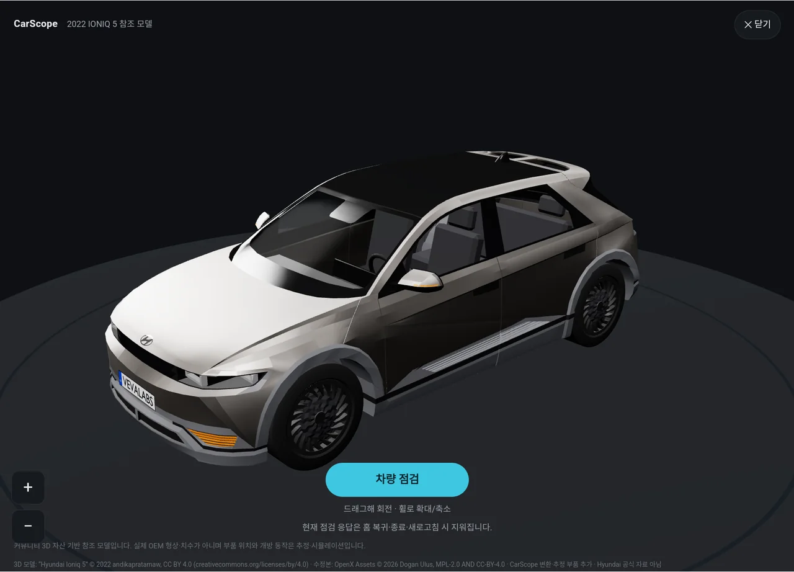
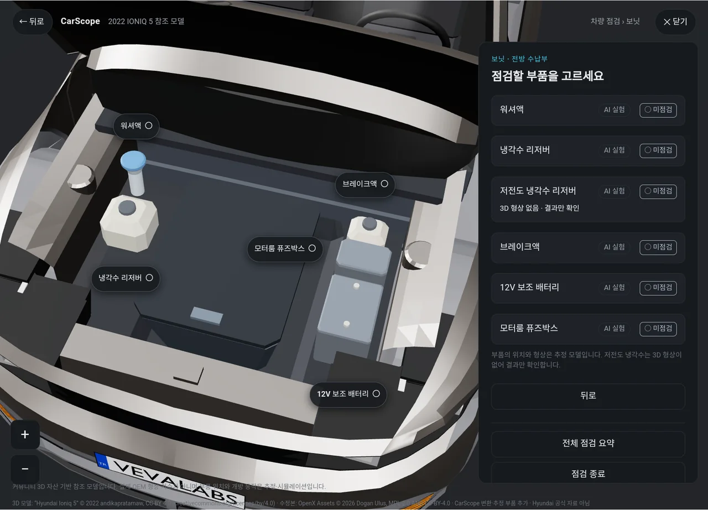
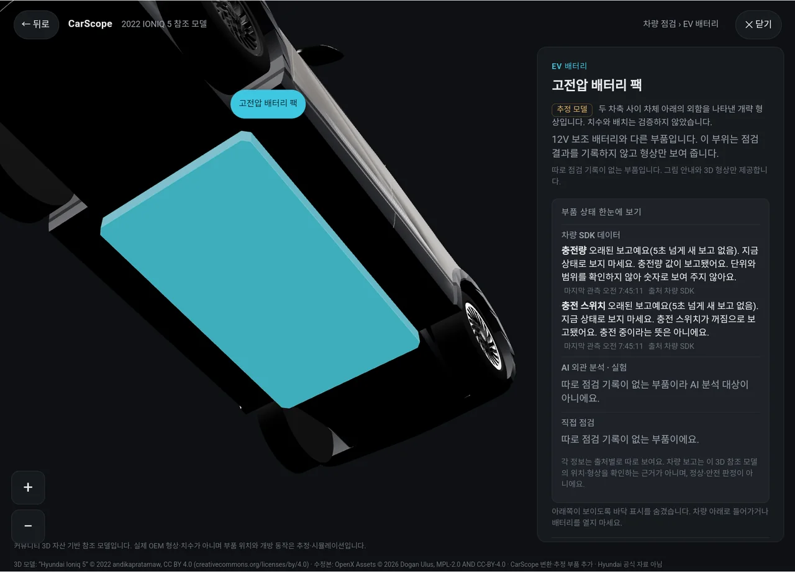
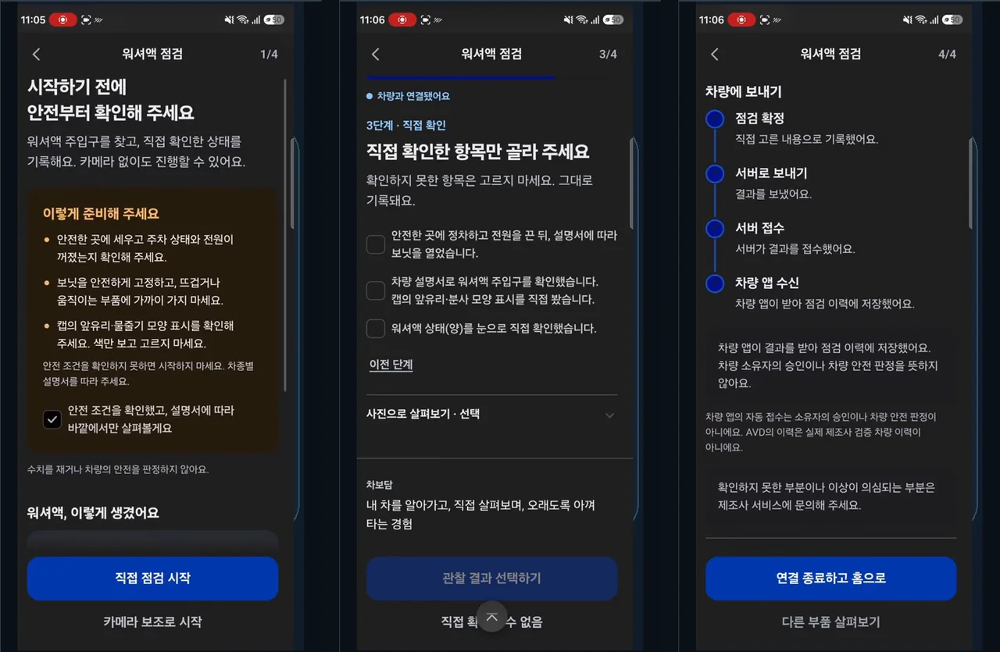
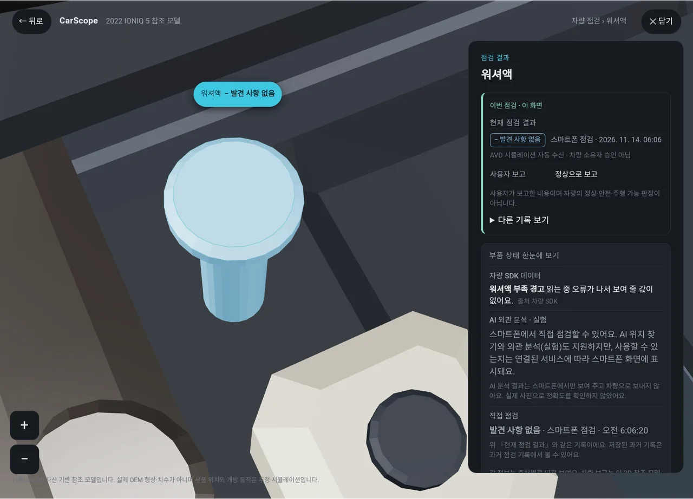
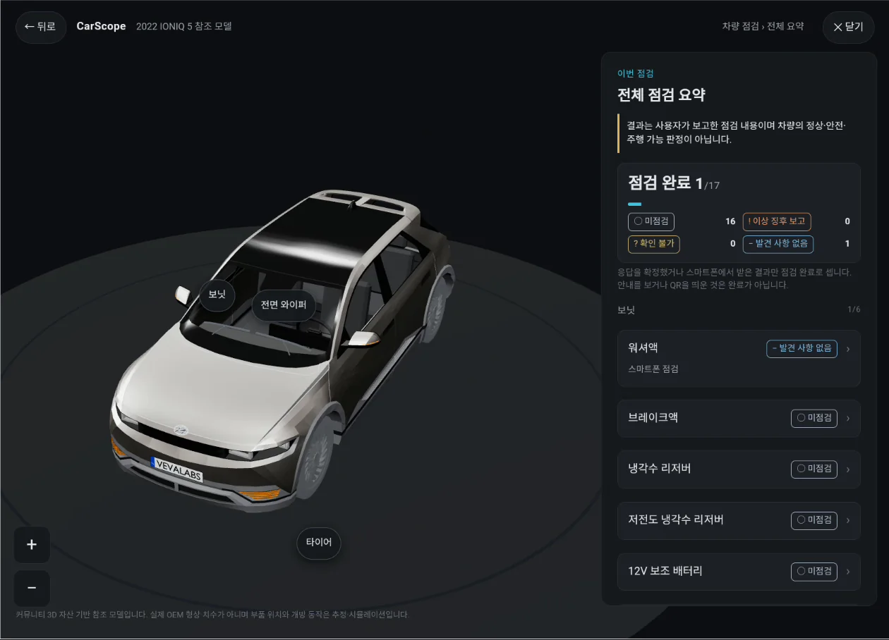
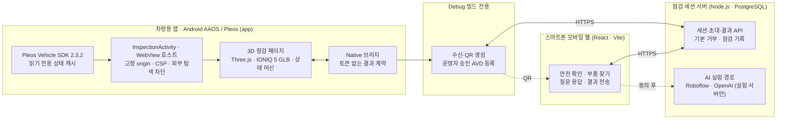

# 차보담 (CarScope)

**차량에서 시작하는 스마트 점검.** 차량 화면의 3D 모델에서 내 차의 부품을 찾아 이해하고, 스마트폰으로 이어서 직접 점검한 뒤, 결과를 다시 차량 화면에서 확인합니다.

처음 차를 갖게 된 운전자는 워셔액 주입구가 어디인지, 보닛 안의 리저버가 무엇인지, 차량이 알려 주는 상태가 어느 부품과 관련되는지 알기 어렵습니다. 차보담은 Pleos 차량용 앱(Android Automotive)과 스마트폰 모바일 웹을 하나의 점검 흐름으로 연결합니다.

- **차량에서 이해하기:** 3D IONIQ 5 참조 모델에서 부위를 고르면 보닛이 열리고 부품이 강조되며, 위치·주의사항과 함께 차량이 보고한 상태를 출처와 함께 보여 줍니다.
- **스마트폰에서 확인하기:** QR로 이어진 모바일 웹이 안전 확인 → 부품 찾기(카메라·AI 실험) → 직접 확인한 항목 기록 → 차량으로 결과 전송을 안내합니다.
- **출처를 섞지 않기:** 차량 SDK 값, 사용자 보고, 추정 형상, AI 참고 정보를 따로 표시합니다. 값이 없거나 권한이 없거나 오래된 경우도 구분하며, 어떤 결과도 차량의 정상·안전 판정으로 표시하지 않습니다.

> 2026 현대자동차그룹 차량용 앱 개발 공모전 제출작입니다. 검증은 **Pleos Connect AVD(에뮬레이터)** 에서 했으며, **실차에서는 검증하지 않았습니다.** 3D 모델과 부품 형상은 OEM 자료가 아닌 커뮤니티 모델과 추정 형상입니다.

## Demo

https://github.com/user-attachments/assets/62d618ce-9da3-4f5a-98bb-f3327678c64b

<sub>왼쪽: 차량용 앱(Pleos AVD), 오른쪽: 실제 스마트폰의 모바일 웹. 3D 탐색 → 보닛 개방 → 워셔액 → QR → 스마트폰 직접 점검 → 차량 수신 → 전체 요약(111초). **Debug 빌드와 운영자가 승인한 AVD 시뮬레이션 등록으로 촬영했습니다.** 제출용 Release APK에는 QR 스마트폰 연동이 없습니다([Debug와 Release](#debug와-release)). QR 스캔 구간은 초대 토큰 보호를 위해 흐림 처리했습니다. 원본 1920×1080을 GitHub 첨부 용량에 맞게 재인코딩했습니다(길이·프레임 수 동일).</sub>

## Key Features

| 기능 | 내용 | Release APK |
| --- | --- | --- |
| **3D 차량 탐색** | Three.js로 IONIQ 5 참조 모델을 렌더링. 회전·확대/축소, 부위 이름표, 레이캐스트 선택, 부품별 카메라 이동 | 포함 |
| **보닛 개방과 부품 강조** | 보닛 0→60° 개방(추정 회전축), 전방 수납부 부품, 타이어·EV 배터리(하부 보기)·충전구·와이퍼·전조등 강조 | 포함 |
| **부품 안내** | 부품 위치(추정), 안전 확인, 주의사항. 워셔액은 Hyundai 정비 설명서 해당 절을 출처로 표시 | 포함 |
| **타이어 셀프 점검 (차량 화면)** | 네 타이어별 육안 질문 3개 → 확정·수정 → 요약. 사용자 보고(`USER_REPORTED`) | 포함 |
| **차량 상태 카드** | Pleos Vehicle SDK 2.3.2 읽기 전용: EV 충전량·충전 스위치·충전구, 전면 와이퍼, 하향등·상향등, 주행거리. 출처·관측 시각·`STALE`(5초) 표시 | 포함 (AVD 수신 확인) |
| **전체 점검 요약** | 17개 점검 항목의 완료 수와 상태별 집계, 부품별 결과 | 포함 |
| **스마트폰 점검 (QR)** | 차량이 QR 발급 → 모바일 웹에서 안전 확인·부품 찾기·질문 응답 → 서버 경유로 차량에 결과 반영 | **미포함** (Debug + 운영자 승인 AVD) |
| **AI 실험 (스마트폰)** | 사용자 동의 후 Roboflow 부품 위치 후보, OpenAI 외관 설명. 참고 정보이며 차량으로 보내지 않음 | 해당 없음 (모바일 웹 기능) |

부품은 [하나의 레지스트리](tools/three-poc/inspection-parts.mjs)에 19개가 있고, 그중 17개가 점검 항목입니다. 지원 방법은 부품마다 다릅니다.

| 영역 (부품 수) | 3D 강조 | 차량 화면에서 응답 | 스마트폰 점검 | AI 실험 | 차량 SDK 상태 |
| --- | --- | --- | --- | --- | --- |
| 보닛 내부 (6): 워셔액, 냉각수, 저전도 냉각수, 브레이크액, 12V 배터리, 퓨즈박스 | 5개 추정 형상 (저전도 냉각수는 형상 없음) | — | 6개 | 위치 후보+분석 4개, 직접 표시+분석 2개 | 워셔액 경고·브레이크액 레벨: AVD 미제공 |
| 타이어 (4) | 모델 원본 메시 | 4개 | 4개 | 분석 초안 (운영자 승인 필요) | 공기압·저압 경고: AVD 미제공 |
| EV 충전구 (1) + 덮개 (보기만) | 추정 형상 | — | 1개 | 분석 초안 | 충전구 개폐 **수신 확인** |
| 전면 와이퍼 (2) | 추정 마커 | — | 2개 | 분석 초안 | 와이퍼 상태 **수신 확인** |
| 전조등 (4) | 모델 마커 | — | 4개 | 분석 초안 | 하향등·상향등 **수신 확인** (좌우 구분 없는 전역 값) |
| EV 배터리 팩 (보기만) | 추정 하부 외함 | — | — | — | 충전량·충전 스위치 **수신 확인** (단위 미확인이라 숫자는 표시하지 않음) |

주행거리는 요약의 "차량 정보" 카드에 표시합니다. 스마트폰은 19개 부품 모두에 그림 안내를 제공합니다. AI 지원 단계와 근거는 [부품별 점검 방법](docs/p11-part-capabilities.md), [11개 외부 부품 초안](docs/p13-g-vision-11-parts.md)에 있습니다.

## Product Gallery

| 차량: 3D 홈 (Release) | 차량: 보닛 개방과 부품 목록 (Release) |
| --- | --- |
| [](docs/visuals/readme/chabodam-01-vehicle-home.webp) | [](docs/visuals/readme/chabodam-02-hood-parts.webp) |
| 모델 회전·확대/축소. 하단에 모델 출처와 라이선스를 상시 표시합니다. | 보닛 안 6개 부품. 형상과 위치는 추정이며 저전도 냉각수는 결과만 다룹니다. |

| 차량: SDK 상태 카드 (Release) | 스마트폰: 안전 확인 → 직접 확인 → 차량 전송 (Debug 연동) |
| --- | --- |
| [](docs/visuals/readme/chabodam-03-sdk-status.webp) | [](docs/visuals/readme/chabodam-04-mobile-flow.webp) |
| AVD Vehicle Service가 보고한 값. 5초 넘게 새 보고가 없으면 오래된 값으로 표시합니다. | 시연 영상의 실제 스마트폰 화면 3장. 확인하지 않은 항목은 고르지 않도록 안내합니다. |

| 차량: 스마트폰 결과 수신 (Debug) | 차량: 전체 점검 요약 (Debug) |
| --- | --- |
| [](docs/visuals/readme/chabodam-05-result-received.webp) | [](docs/visuals/readme/chabodam-06-summary.webp) |
| 사용자 보고 결과와 "AVD 시뮬레이션 자동 수신 · 차량 소유자 승인 아님"을 함께 표시합니다. | 응답을 확정했거나 스마트폰에서 받은 결과만 완료로 셉니다. |

차량 화면은 Pleos AVD(2560×1440)의 앱 영역을 잘라낸 실제 캡처이고, 스마트폰은 시연 영상의 실제 프레임입니다. 3D 이미지: “Hyundai Ioniq 5” © 2022 [andikapratamaw](https://sketchfab.com/andikapratamaw), [CC BY 4.0](https://creativecommons.org/licenses/by/4.0/); OpenX Assets 수정 © 2026 Dogan Ulus. 출처·편집 방법·해시는 [이미지 기록](docs/visuals/readme/README.md)에 있습니다.

## How It Works

```text
차량 화면                          서버                                 스마트폰
3D에서 부품 선택 ───────────────▶ 점검 세션 생성 (등록 확인)
"스마트폰으로 점검하기"            QR 초대 (단기 토큰) ──── QR ────▶ 모바일 웹 열기 · 세션 연결
                                                                    안전 확인 → 부품 찾기 → 질문 응답
                                   결과 접수 (형식·다이제스트 검증) ◀── 결과 전송
결과 검증 후 3D·요약에 반영 ◀──── 차량 수락 → 점검 기록 저장 (PostgreSQL)
```

- 차량 앱은 결과를 **서버 세션과 Native 검증**을 거친 뒤에만 반영합니다. 웹 페이지는 QR·토큰을 갖지 않습니다. QR은 Native가 페이지 위에 그리고, 표시 중에는 화면 캡처를 막습니다.
- 차량 화면의 이번 점검 상태는 **앱 메모리**에만 있습니다(홈 복귀·종료·닫기 시 삭제). 차량이 수락한 결과는 **서버의 PostgreSQL 점검 기록**에 저장됩니다. 서버에는 기록 조회 API가 있지만 기본은 거부이며, 차량 화면의 "저장된 과거 점검 기록"은 아직 조회 경로가 연결되지 않아 "연결되지 않았습니다"로 표시합니다(Debug·Release 모두).
- AI 분석 결과는 스마트폰에서만 보여 주고 차량으로 보내지 않습니다. 차량에 반영되는 것은 사용자가 고른 응답입니다.

### Debug와 Release

| | Debug 빌드 + 운영자 승인 AVD (시연 영상) | 제출 Release APK |
| --- | --- | --- |
| 3D 점검·보닛·부품 안내·타이어 응답·요약 | 지원 | **지원** · AVD 설치·실행 확인 |
| 차량 SDK 상태 (EV·충전구·와이퍼·전조등·주행거리) | 지원 | **지원** · AVD 값 수신 확인 |
| 워셔액·브레이크액·타이어 SDK 상태 | 권한 포함, AVD가 값을 주지 않아 오류·미지원으로 표시 | 권한 제외(`CAR_SAFETY`·`PRIVATE_CAR_SAFETY`) → `PERMISSION_DENIED` 표시 |
| **QR 스마트폰 연동·결과 수신** | **지원** · 실제 스마트폰과 E2E 실행 (아래 검증) | **미포함 (BLOCKED)** · "이 배포용(Release) 앱에는 스마트폰 점검 연동이 없습니다" 안내 |
| 네트워크 권한 | `INTERNET` 포함 | 없음 |

QR을 만들려면 운영자가 AVD마다 발급하는 등록 증명이 필요합니다. 이는 **운영자 승인 시뮬레이션**이며 차량 소유자 인증이나 VIN 검증이 아닙니다([인증 설계](docs/p6-d3-avd-simulator-auth.md)). Release 앱에는 이 증명을 넣을 안전한 경로가 없어, 인증을 우회하지 않고 연동을 뺐습니다. 자세한 분석과 권한 정책은 [Release 제출 문서](docs/release-submission.md)에 있습니다.

## Architecture



- **인증 경계:** 세션 생성은 기본 거부이고, 운영자가 승인한 AVD 등록만 120초짜리 생성 자격을 받습니다. 초대·제출·수신 토큰은 역할별로 분리됩니다. TLS 검증 우회나 공용 테스트 자격 증명은 없습니다.
- **데이터 출처:** SDK 값은 Native 캐시에서 읽기 전용으로만 들어오고 `SUPPORTED`/`UNSUPPORTED`/`PERMISSION_DENIED`/`ERROR`/`STALE`과 관측 시각을 보존합니다. 실패를 MOCK으로 바꾸지 않습니다.
- **Release 경계:** 수신·QR·서버 통신 코드는 Debug 소스셋에만 있고, CI가 Release APK/AAB에 들어가지 않았는지 검사합니다.
- 기존 도어 상태 화면(`MainActivity`)은 순수 Kotlin `vehicle-core`로 도어 상태를 SVG로 그립니다.

## Tech Stack

| 영역 | 기술 |
| --- | --- |
| 차량용 앱 | Kotlin, Android WebView, Pleos Vehicle SDK 2.3.2, Android 14 / API 34 (minSdk 28), Gradle |
| 3D 화면 | JavaScript ES modules, Three.js 0.160 (GLTFLoader, OrbitControls), glTF/GLB, Raycaster |
| 모바일 웹 | React 19, TypeScript, Vite, Astryx design system, Web Camera API, Canvas |
| 서버 | Node.js 22, PostgreSQL (`pg`), HTTPS (Render), 운영자 등록 CLI |
| AI 실험 | Roboflow 호스팅 탐지 모델, OpenAI 비전 분석 (서버 경유, 호출 상한·사용자 동의) |
| Core | 순수 Kotlin JVM `vehicle-core` (상태 매핑·SVG) |
| 검증 | JUnit·Robolectric, Node test runner, Playwright, Geometry 회귀, Debug/Release 경계 검사, GitHub Actions |

## Download & Installation

| 항목 | 내용 |
| --- | --- |
| APK | [`apk/박성진_차보담_release.apk`](apk/박성진_차보담_release.apk) · [직접 다운로드](https://github.com/ppsssj/CarScope/raw/main/apk/%EB%B0%95%EC%84%B1%EC%A7%84_%EC%B0%A8%EB%B3%B4%EB%8B%B4_release.apk) |
| SHA-256 | `bdd9b022b6f7c8ee3b20061e65c8d27193414e80ec8f20a5bedde56fb7198d59` |
| 크기 | 9,398,309 bytes |
| 패키지 / 버전 | `io.carscope.app` / `1.0.0` (versionCode 2), Release 서명 (APK Signature Scheme v3), debuggable 아님 |
| 서명 인증서 SHA-256 | `ce8926f6528e56b5506a4c6c72bc0b0b7eea07803d52a14ead3f1b5f8e3700db` |
| 테스트 환경 | Pleos Connect 에뮬레이터 **v2.1.0** 시스템 이미지(`system-images;android-34;pleos_car_emulator;x86_64`, Android 14 / API 34), 기기 프로필 `Pleos_Connect_v2_0`, Vehicle Service 2.3.22, Android Emulator 37.2.13, Windows 10, Android user 10 |
| 화면 규격 | **2560 × 1440 px, 160 dpi** (가로). 앱은 오른쪽 앱 영역(약 1680 × 1210 px)에서 실행 |

1. Pleos Connect v2.1.0 AVD를 Cold Boot로 부팅합니다([설치 안내](docs/development-setup.md#7-pleos-avd)).
2. 같은 패키지(`io.carscope.app`)의 다른 서명 빌드(Debug 등)가 설치돼 있으면 설치가 거부됩니다. 별도 AVD를 쓰거나 기존 앱 데이터를 확인한 뒤 직접 정리하세요.
3. 설치하고 실행합니다. 권한(`CAR_ENERGY`, `CAR_WINDOWS`, `CAR_LIGHTS`, `CAR_DRIVE`, `CAR_DOORS`)은 설치할 때 허용되며 따로 설정할 것은 없습니다.

```powershell
adb install 박성진_차보담_release.apk
adb shell am start --user 10 -n io.carscope.app/.lab.InspectionActivity
```

Android 사용자 번호는 `adb shell am get-current-user`로 확인합니다. 런처에서는 **차보담 차량 점검**을 누릅니다. **차량 점검**을 누른 뒤 3D 모델의 부위나 오른쪽 목록을 고르고, 왼쪽 아래 `+`/`−`로 확대·축소합니다. 런처의 다른 아이콘(CarScope P0)은 기존 도어 상태 SVG 화면입니다.

## Verification & Limitations

| 대상 | 결과 | 환경·근거 |
| --- | --- | --- |
| Release APK 설치·실행 | 설치, 3D 렌더링, 보닛·부품 상세, 요약, 닫기 PASS. 앱 크래시 0건 | 별도 검증 AVD, 2026-11-15 · [Release 제출](docs/release-submission.md) |
| Pleos SDK → 상태 카드 | EV 충전량·충전 스위치·충전구, 와이퍼, 하향등·상향등, 주행거리: SDK 수신·WebView 전달·카드 표시 PASS. 도어(기존 화면) PASS | Virtual Console로 값을 바꾼 뒤 복원, 2026-11-14 · [AVD SDK E2E](docs/pleos-avd-sdk-e2e.md) |
| SDK 미제공 항목 | 타이어 공기압·저압 경고, 워셔액·브레이크액: AVD가 값을 주지 않음 (실차 제공 여부 미확인) | 같은 문서 |
| QR → 스마트폰 → 차량 E2E | QR 발급 → 스마트폰 연결 → 결과 수신 → 3D·요약 반영 PASS (워셔액 1건, 직접 점검) | **Debug + 운영자 승인 AVD + 실제 스마트폰**, 2026-11-14 녹화 리포트·시연 영상, 사용자 실행 |
| 서버·인증·저장 | 세션·토큰 분리, 기본 거부, PostgreSQL 16/17 저장·복구, AVD 등록·폐기 | CI (합성·로컬 DB) · [진단 도구](docs/p22-avd-qr-auth-diagnostics.md) |
| 모바일 웹 | React 흐름·카메라 AI 흐름 브라우저 E2E, 접근성 검사 | CI·Playwright (합성 카메라, AI는 MOCK) · [P21](docs/p21-camera-ai-inspection-flow.md) |
| AI 실험 | Roboflow 탐지: 공개 사진 대상 실제 호출 평가(로컬). OpenAI 분석: 워셔액 실제 호출 4회 스모크(로컬). 정확도 미확립 | [P12-F](docs/p12-f-real-part-detection.md), [P13-D](docs/p13-d-multipart-vision.md) |
| Geometry | 서비스 부품·프렁크 표본 회전 검사에서 교차 0 | 표본 검사이며 연속 회전 전체·OEM 기구의 무충돌 증명이 아님 |
| 자동 테스트 | 앱 JVM 293개, 3D 화면 Node 355개(1개 TODO) 통과, PR CI 19개 job 통과 | 2026-11-15 로컬 실행·PR #134 |

**검증하지 않은 것**
- 실차, 실제 Pleos 차량 HAL에서의 권한·값 수신.
- Release APK의 QR 연동(설계상 미포함)과 심사자 기기용 등록 절차.
- 스마트폰과 Render를 거치는 실제 AI 호출 E2E, 실제 차량 사진 기준 AI 정확도.
- 차량 화면에서의 과거 기록 조회(서버 API는 있음, 화면 연결 없음).
- 성능: AVD에서 3D는 약 15~17fps이며 개발 PC GPU 경로의 값입니다.

## Development & References

```powershell
# 3D 점검 화면 (브라우저) · Node.js 22 · 로컬에서 준비한 GLB 경로가 필요합니다
npm ci --ignore-scripts --prefix tools/three-poc
$env:CARSCOPE_IONIQ5_GLB = 'C:\CarScope-External\ioniq5-carscope\hyundai_ioniq_5_2022.glb'
$env:PORT = '8098'; npm run serve --prefix tools/three-poc   # http://127.0.0.1:8098/inspect.html

# 모바일 웹 (Vite 개발 서버)
npm ci --prefix tools/mobile-ar-poc; npm run dev --prefix tools/mobile-ar-poc

# 테스트
node --test tools/three-poc/test/*.test.mjs
npm run check --prefix tools/mobile-ar-poc; npm test --prefix tools/mobile-ar-poc
.\gradlew.bat -PcoreOnly=true :vehicle-core:test --console=plain        # Android SDK 없이 core만
.\gradlew.bat :app:testDebugUnitTest :app:assembleDebug :app:assembleRelease
```

- Android 앱의 3D 자산은 `node tools/three-poc/build-android-inspection.mjs`로 생성합니다. Release APK 서명 빌드는 [Release 제출 문서](docs/release-submission.md#6-빌드-재현)를 따릅니다.
- 문서: [개발 환경](docs/development-setup.md) · [아키텍처](docs/architecture.md) · [Pleos SDK 연동](docs/pleos-sdk-integration.md) · [모바일 웹 차보담](docs/p20-chabodam-mobile-ui.md) · [카메라 AI 흐름](docs/p21-camera-ai-inspection-flow.md) · [AVD QR 인증 진단](docs/p22-avd-qr-auth-diagnostics.md) · [3D 점검 UI](tools/three-poc/INSPECTION_UI.md) · [로드맵](docs/roadmap.md) · [검증 기록](docs/validation-report.md)
- 이전 단계의 브라우저 PoC 캡처(QR-AR, P3-A4 흐름, P2-A6 렌더)는 [이미지 기록](docs/visuals/readme/README.md#이전-poc-갤러리)과 [IONIQ 5 자산 문서](docs/p2-a6-ioniq5-asset.md)에 남겨 두었습니다.

### Model, References & Attribution

- 3D 모델: “Hyundai Ioniq 5” © 2022 [andikapratamaw](https://sketchfab.com/andikapratamaw), [CC BY 4.0](https://creativecommons.org/licenses/by/4.0/) → [OpenX Assets](https://github.com/vevalabs/openx-assets) 수정본 © 2026 Dogan Ulus, `MPL-2.0 AND CC-BY-4.0`. CarScope가 GLB로 변환하고 보닛 회전, 전방 수납부·서비스 부품 추정 형상, 강조·UI를 더했습니다. **현대자동차 공식 CAD가 아닙니다.**
- 저장소에는 원본 모델·변환 GLB를 커밋하지 않습니다. 예외로 제출 APK(`apk/`)는 변환 GLB를 포함하며, 앱 3D 화면 하단에 저작자·라이선스를 상시 표시합니다. 자세한 정책은 [IONIQ 5 자산 문서](docs/p2-a6-ioniq5-asset.md)에 있습니다.
- 워셔액 점검 절차와 부품 존재 근거: [Hyundai UK IONIQ 5 2022 Maintenance PDF](https://manuals.hyundai.co.uk/umanuals/ioniq-5/ioniq-5-2022-maintenance.pdf). 실제 배치와 정비 방법은 사용자 차량의 설명서로 다시 확인해야 합니다.
- CarScope·차보담은 Hyundai와 관련이 없으며, 이 자료는 Hyundai의 보증이나 공식 인증을 뜻하지 않습니다. 차량 디자인과 상표는 각 권리자에게 있습니다.
- 저장소에는 원본 실행 증거(기기 캡처·로그), 인증 토큰·등록 증명, 서명 키, SDK 바이너리를 넣지 않습니다.
