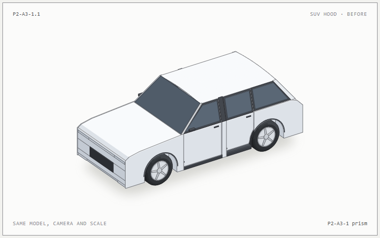
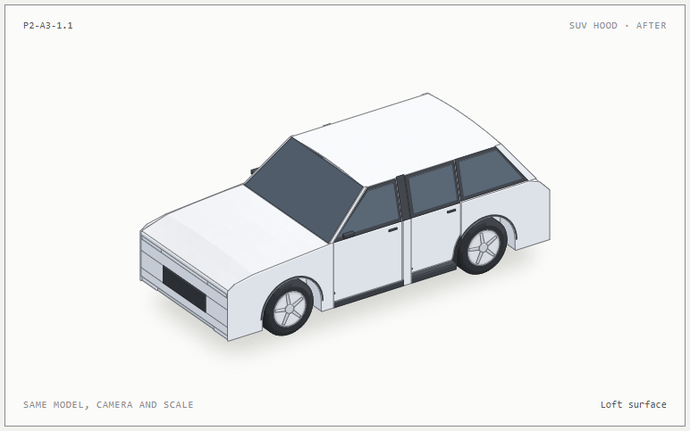
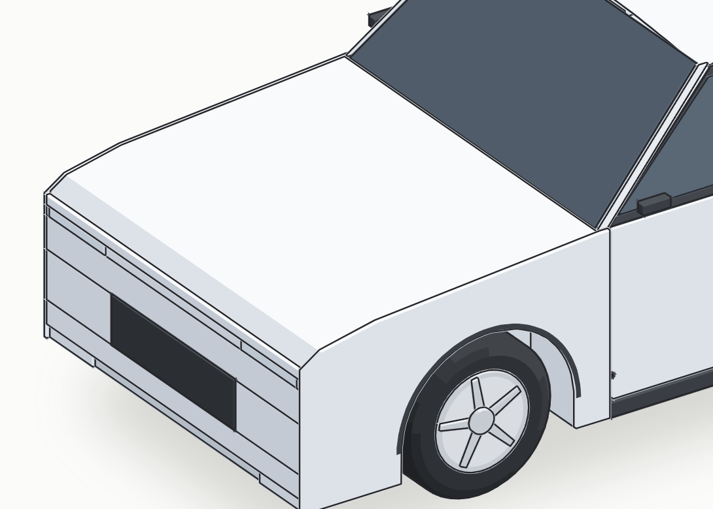
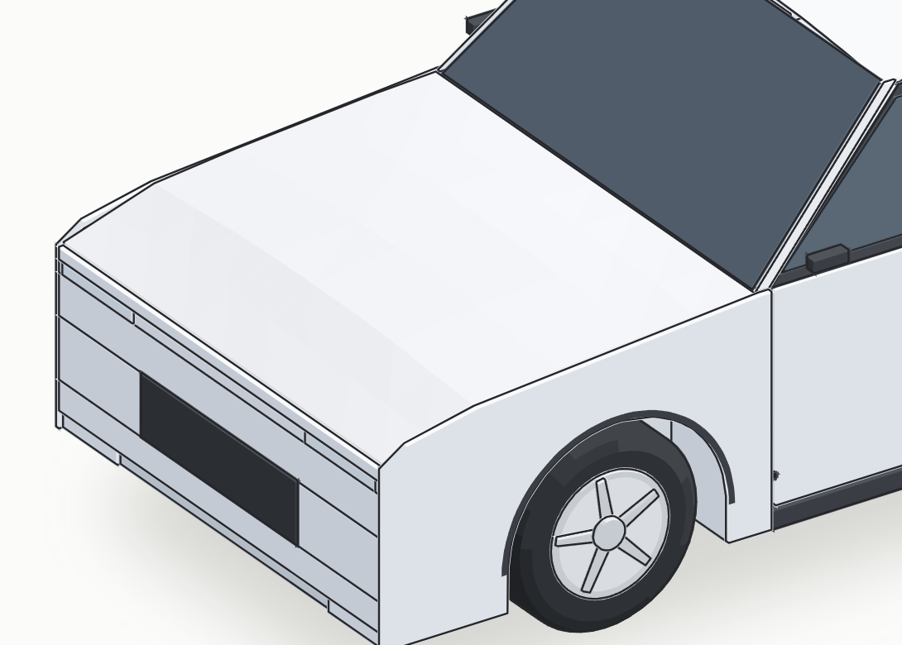
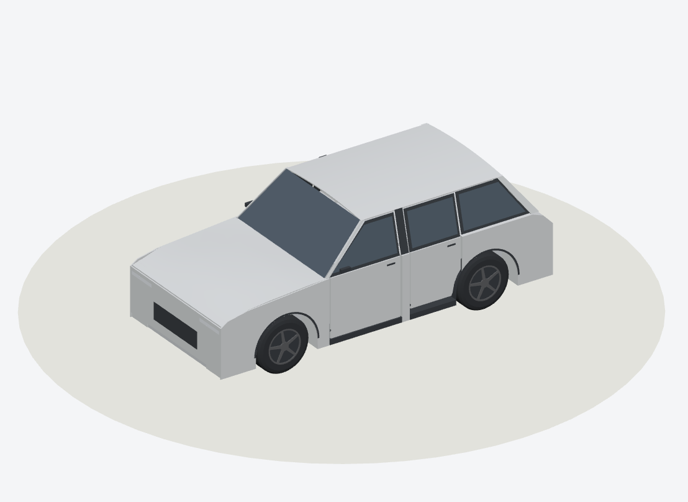
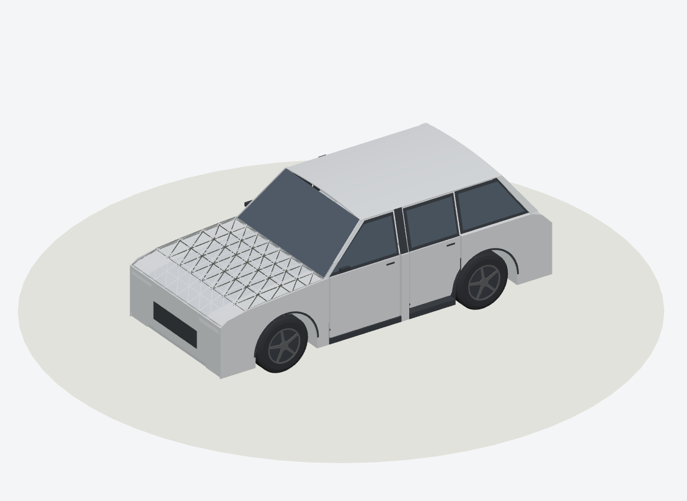

# P2-A3-1.1 · SUV hood Loft MVP

These images are actual CarScope SVG and GLB renders from the same SUV geometry builder. `before` selects the preserved P2-A3-1 hood prism; `after` selects the opt-in section loft. The SVG pair uses one Anatomy projection and the GLB side pair uses the same exact orthographic camera. Captured with Node 22.16.0, pinned Anatomy `1482e8469b0a9e0d8cc18ea2740a01423d29ae80`, and the local Three.js debug Lab. No OEM image or AI generated image is used.

| Before · front 3/4 SVG | After · front 3/4 SVG |
| --- | --- |
|  |  |

| Before · 4× SVG hood detail | After · 4× SVG hood detail |
| --- | --- |
|  |  |

The detail views are equal pixel crops of real 4× captures. The after view shows a centre crown and gradual transverse/longitudinal face changes. The visible banding is limited by the current tessellation and SVG face shading; it is not a Class-A automotive surface.

| Before · GLB left side | After · GLB left side |
| --- | --- |
|  |  |

| After · shaded GLB | After · hood wireframe GLB |
| --- | --- |
|  |  |

The side silhouette rises gently around the bonnet centre. The shaded GLB difference is subtler at full vehicle scale; the wireframe exposes the new surface triangles. Model length, width, height, wheel positions and door poses remain unchanged. This is AAOS AVD based reference geometry, not a validated OEM exterior. Hood/fender seam continuity, detailed lights, underbody and cabin remain outside this MVP.

## Reproduce

```powershell
npm run envelope --prefix tools/anatomy-car
node tools/anatomy-car/envelope/compare-loft.mjs
$server = Start-Process -FilePath node -ArgumentList 'tools/three-poc/serve.mjs' -WorkingDirectory (Get-Location).Path -PassThru -WindowStyle Hidden
$capture = Join-Path $HOME '.claude/skills/anatomy/scripts/capture.mjs'
node $capture tools/anatomy-car/build/loft/before.html --out .tools/p2-a311/hood-before-front-3q.png --width 1100 --height 650 --scale 1 --wait 2000
node $capture tools/anatomy-car/build/loft/after.html --out .tools/p2-a311/hood-after-front-3q.png --width 1100 --height 650 --scale 1 --wait 2000
node $capture tools/anatomy-car/build/loft/before.html --out .tools/p2-a311/hood-before-x4.png --width 1100 --height 650 --scale 4 --wait 2000
node $capture tools/anatomy-car/build/loft/after.html --out .tools/p2-a311/hood-after-x4.png --width 1100 --height 650 --scale 4 --wait 2000
node tools/anatomy-car/envelope/capture-loft.mjs .tools/p2-a311 http://127.0.0.1:8095/
python tools/anatomy-car/envelope/publish-loft.py .tools/p2-a311
Stop-Process -Id $server.Id
```

The capture requires the exact pinned Anatomy checkout and locked Three.js dependencies; publication requires Python Pillow. `capture-loft.mjs` checks the model, camera direction and console. `publish-loft.py` rejects absent captures. Open each image and inspect the visible form before committing.
