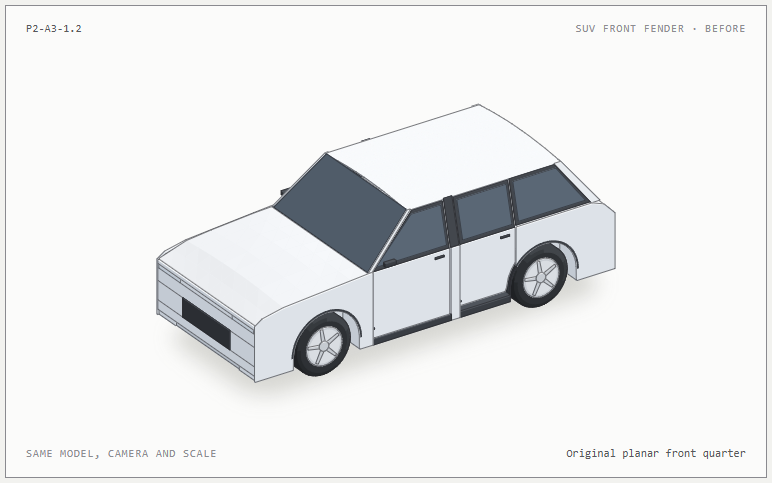
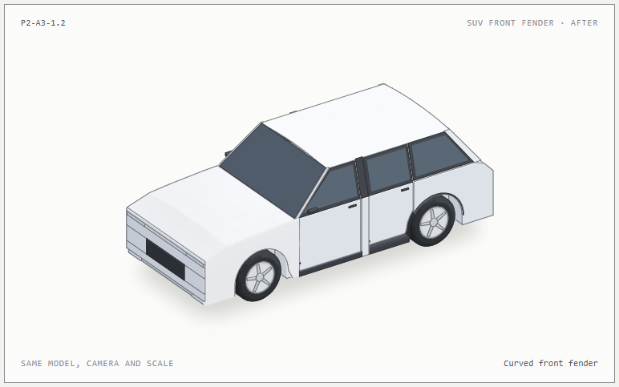
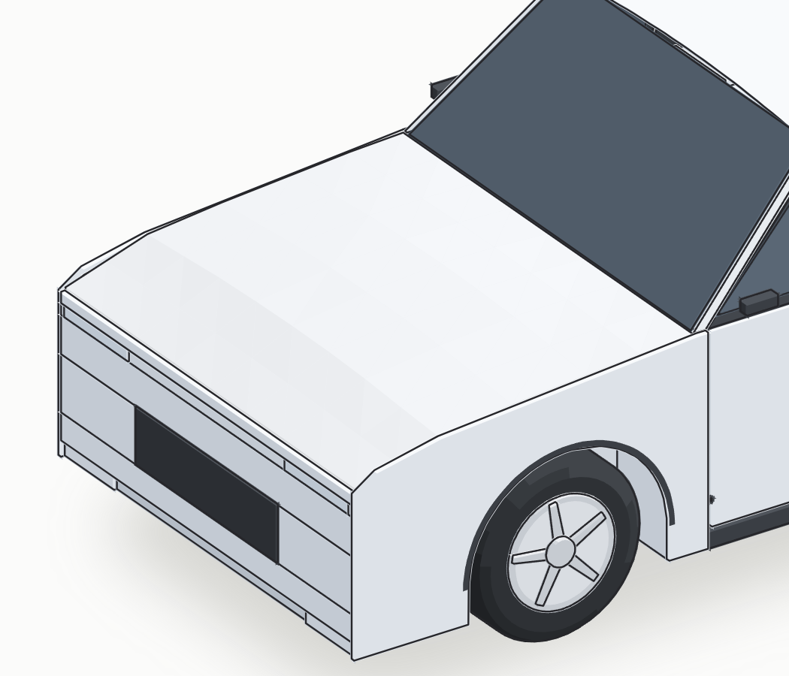
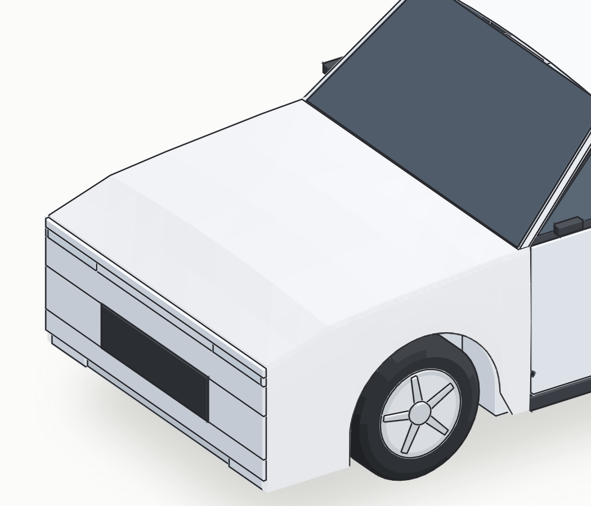
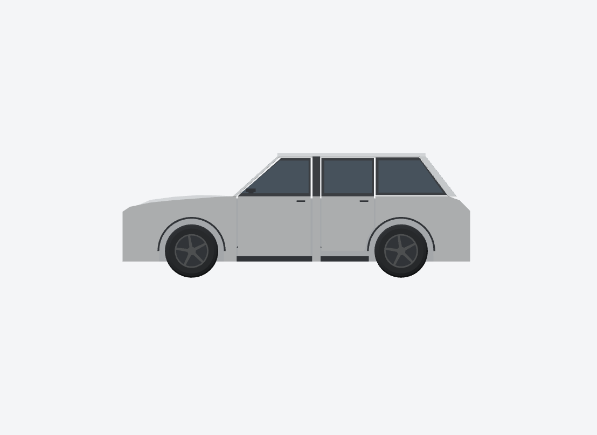
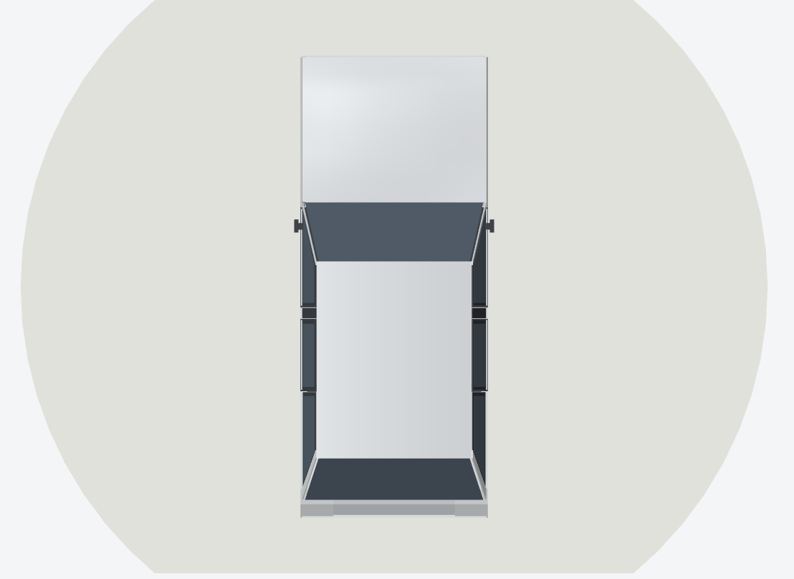
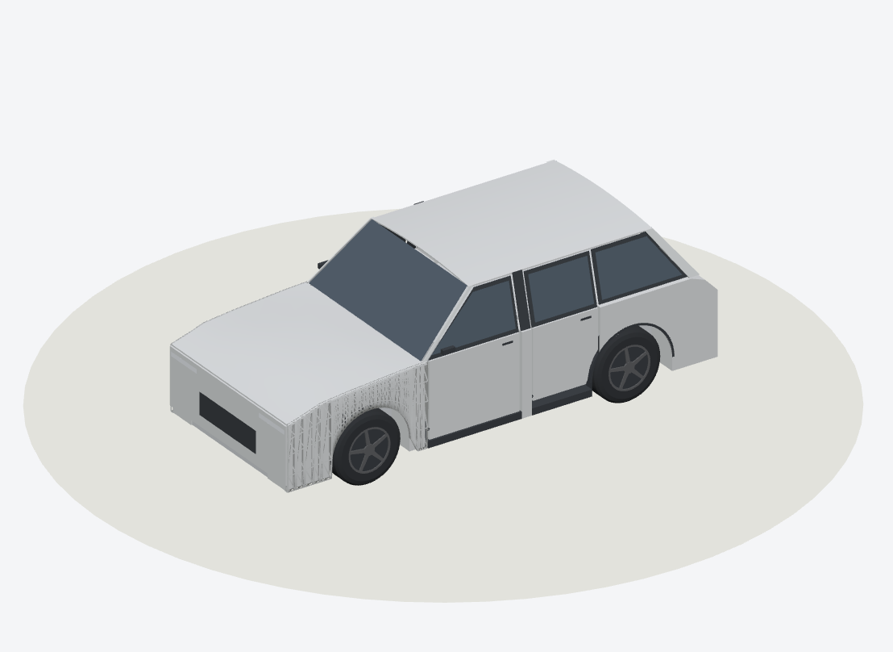

# P2-A3-1.2 · Front fender and hood boundary

These ten PNGs are actual CarScope renders from the same procedural SUV builder. `before` selects the preserved P2-A3-1.1 front-quarter prisms; `after` selects the wheel-arch-aware front-fender meshes. SVG pairs use the same Anatomy projection, 4× detail pairs use the same pixel crop, and GLB side pairs use the same orthographic Three.js camera. Captured on Windows with Node 22.16.0, pinned Anatomy `1482e8469b0a9e0d8cc18ea2740a01423d29ae80`, and the local Three.js Lab. No reference photo or AI image is used.

## Before / after

| Planar front quarter · SVG | Curved front fender · SVG |
| --- | --- |
|  |  |

| Planar arch · 4× SVG detail | Curved arch and hood seam · 4× SVG detail |
| --- | --- |
|  |  |

| Before · GLB left side | After · GLB left side |
| --- | --- |
|  |  |

The GLB side and 3/4 views show a rounded shoulder above the front wheel and a less planar front side. The SVG detail shows the same geometry, though its triangle-based shading makes the change subtler and the wheel-arch edge remains stylized. The entire car still reads as a boxy reference prototype.

## After views and SVG / GLB

| Front · GLB | Top · GLB |
| --- | --- |
|  |  |

| SVG front 3/4 | GLB front 3/4 |
| --- | --- |
|  |  |

| Shaded GLB | Actual GLB triangle wireframe |
| --- | --- |
|  |  |

The SVG and GLB use the same fender cross-section coordinates. The SVG renders visible mesh triangles without filling the convex hull across the wheel opening. The GLB uses averaged surface normals where valid and flat normals around the tight inner seam. Wireframe shows the added front-fender facets, not a material-only smoothing effect.

## Boundary, mesh and limits

At the hood-edge sample stations the height difference is 0 and the deliberate panel gap is 2 mm. The sampled adjacent surface-normal angle is 5.5° mean, 8.2° maximum. Because the panels are separated, this is **visual tangent alignment**, not mathematical G1 continuity. G2 is unverified. The closed front fender meshes have no degenerate triangles, flipped normals, non-manifold edges or open boundary edges. The four-door sampled collision policy remains 0.3 cm; it is not a continuous-motion proof.

In one final-code local comparison run: before 143 parts / 11,340 triangles / 688 front-quarter triangles; after 141 parts / 13,068 triangles / 2,312 front-fender triangles. Total growth is 1,728 triangles. Model generation took 9,133 ms before and 10,275 ms after, export 329 ms and 228 ms respectively. These single-run timings include Anatomy setup and are diagnostic, not a performance benchmark.

This is AAOS AVD based reference geometry. Actual OEM appearance is unverified; curvature, arch, panel depth and shoulder drop are design estimates. The 55 mm hood crown is retained. The front fascia, doors, rear quarter and roof remain mostly planar, the wheel-arch trim is simplified, and no Class-A surface or full-body self-intersection proof is claimed.

## Reproduce

```powershell
npm run envelope --prefix tools/anatomy-car
node tools/anatomy-car/envelope/compare-fender.mjs
$server = Start-Process -FilePath node -ArgumentList 'tools/three-poc/serve.mjs' -WorkingDirectory (Get-Location).Path -PassThru -WindowStyle Hidden
node tools/anatomy-car/envelope/capture-fender.mjs .tools/p2-a312 http://127.0.0.1:8095/
python tools/anatomy-car/envelope/publish-fender.py .tools/p2-a312
Stop-Process -Id $server.Id
```

The capture script checks GLB identity and browser console output; the publish script rejects absent or invalid PNGs. Open the resulting images and inspect them before publication.
