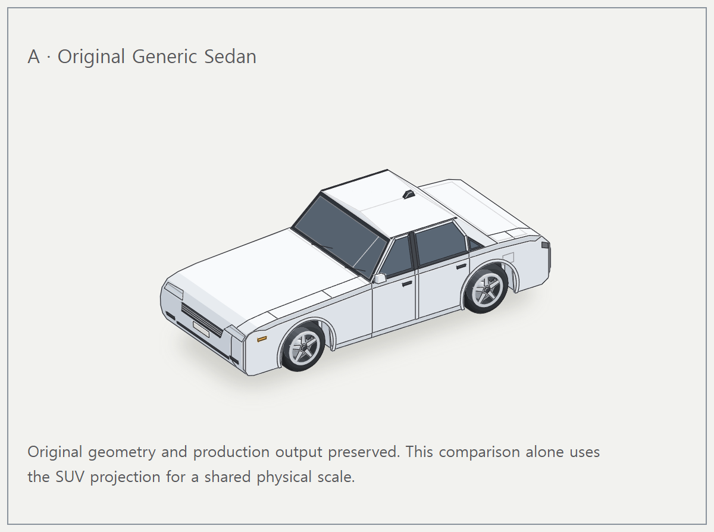
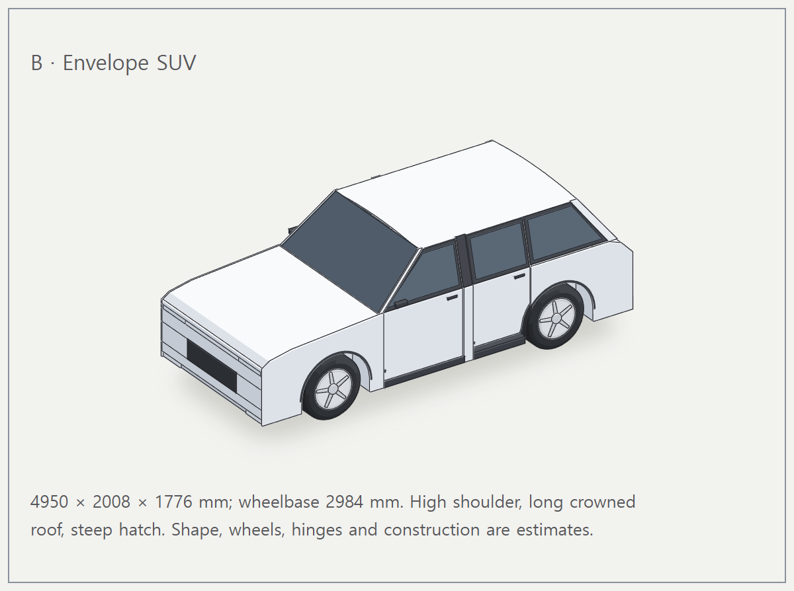
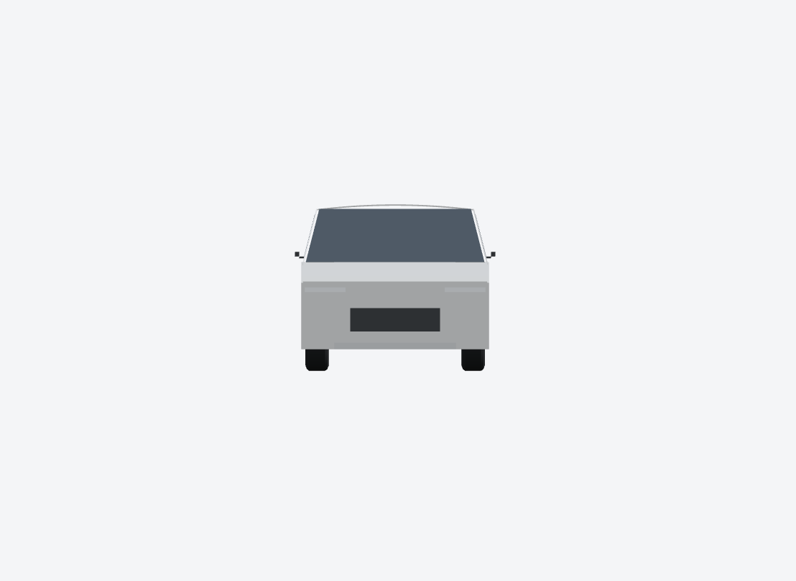
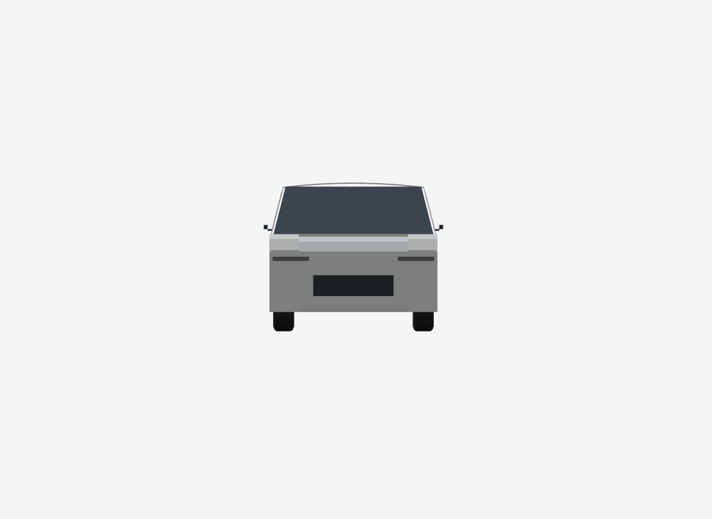
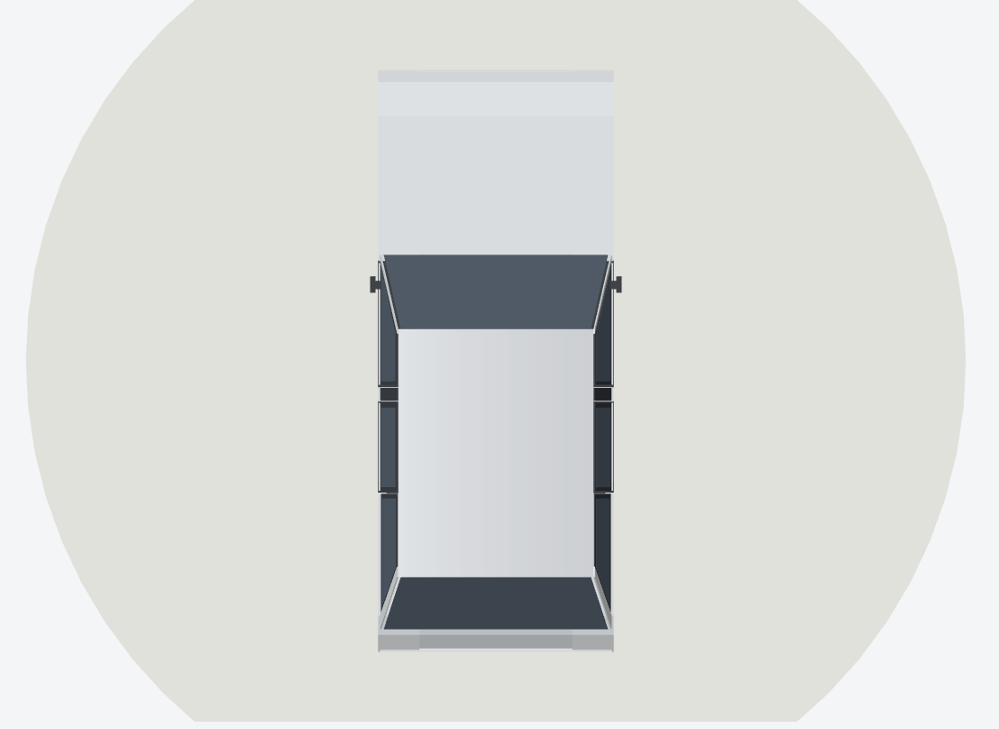
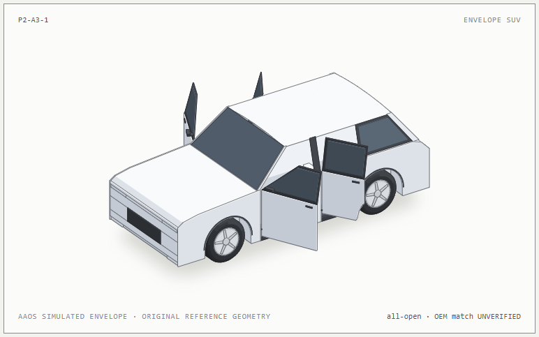
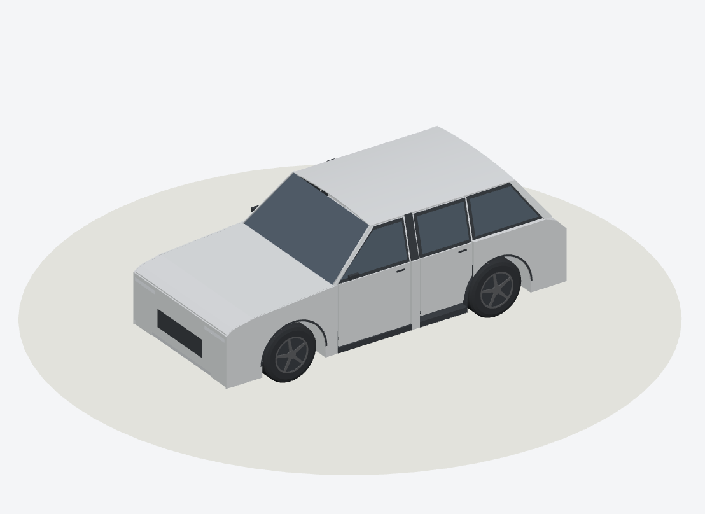
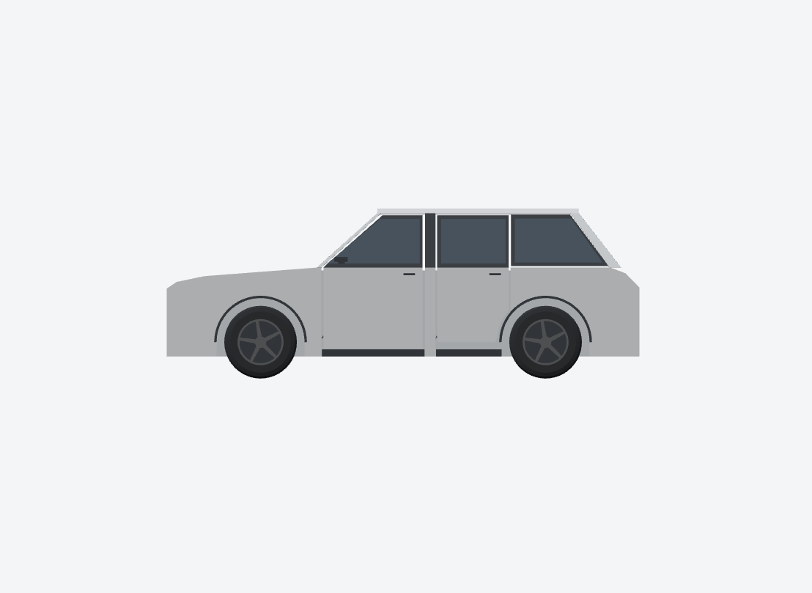
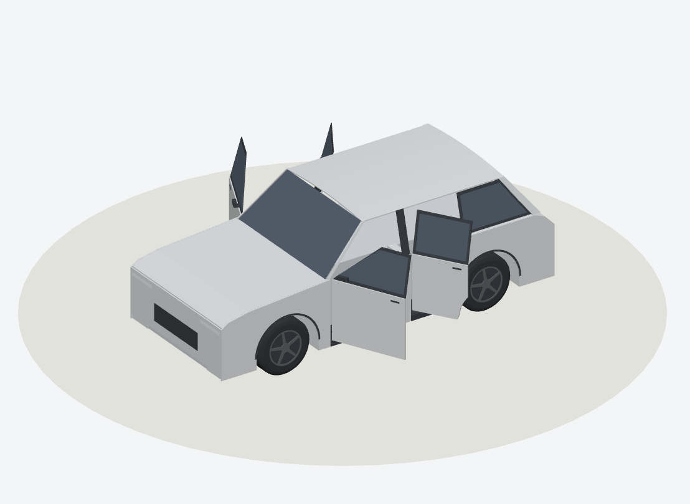

# P2-A3-1 · Vehicle geometry visual evidence

These PNGs show actual CarScope procedural geometry rendered by the pinned Anatomy SVG browser driver or Three.js from the generated GLB. Captured on Windows with Node 22.16.0, Anatomy `1482e8469b0a9e0d8cc18ea2740a01423d29ae80`, and the P2-A3-1 feature branch. The comparison views use the same front-left 3/4 direction and physical scale. This is an AAOS AVD metadata based reference geometry, not a verified OEM exterior.

## Generic Sedan and SUV

| Existing Generic Sedan · SVG | Envelope SUV · SVG |
| --- | --- |
|  |  |

The Sedan and SUV cards come from `comparison-light.html`, using one projection and origin. The SUV has a longer, higher cabin and shorter rear deck. The original Sedan production output remains byte identical.

## SUV views

The orthographic front, side, rear, and top views below are Three.js renders of the same generated SUV GLB. The 3/4, open-door, and hood images are SVG renders. This distinction matters when comparing outlines and shading.

| Front · GLB | Left side · GLB |
| --- | --- |
|  |  |

| Rear · GLB | Top · GLB |
| --- | --- |
|  |  |

| All four doors open · SVG | Hood detail · 4× SVG pixel capture |
| --- | --- |
|  |  |

The hood detail is an unaltered pixel crop from a 4× render, retaining the fascia and windshield for context. It does not show an operable hood.

## SVG and GLB comparison

| SUV SVG | SUV GLB · Three.js |
| --- | --- |
|  |  |

| GLB side | GLB all four doors open |
| --- | --- |
|  |  |

The SVG and GLB use one procedural model and the same physical +X front, +Y left, +Z up convention. The SVG uses Anatomy materials and projection; GLB uses Three.js lighting. The four door poses were also checked by the geometric sweep. Sampled collision checks do not prove every point of continuous rotation.

## Limits and next work

The 4950 × 2008 × 1776 mm envelope, 2984 mm wheelbase, and front/rear tracks come from AAOS AVD simulated metadata. Exterior similarity to any production OEM vehicle is **unverified**. Wheel radius, overhangs, roofline, apertures, hood and panel construction are design estimates. Surface Loft is not applied; panels remain relatively flat with limited compound curvature. Lamps, fascia, wheel details, underbody, and cabin need further modeling. The hood does not open. P2-A3-1.1 may pursue lofted bonnet, fender, and roof surfaces after a separately reviewed shape specification and geometry checks.

## Reproduce

```powershell
npm run build --prefix tools/anatomy-car
npm run export --prefix tools/anatomy-car
npm run envelope --prefix tools/anatomy-car
node tools/anatomy-car/envelope/compare.mjs
$server = Start-Process -FilePath node -ArgumentList 'tools/three-poc/serve.mjs' -WorkingDirectory (Get-Location).Path -PassThru -WindowStyle Hidden
node tools/anatomy-car/envelope/check-visuals.mjs .tools/p2-a31/new-capture http://127.0.0.1:8095/
$driver = Join-Path $HOME '.claude/skills/anatomy/scripts/capture.mjs'
node $driver tools/anatomy-car/build/envelope/comparison-light.html --out .tools/p2-a31/new-capture/sedan-card.png --width 1880 --height 900 --select '.comparison article:nth-child(1)' --scale 2 --wait 2000
node $driver tools/anatomy-car/build/envelope/comparison-light.html --out .tools/p2-a31/new-capture/suv-card.png --width 1880 --height 900 --select '.comparison article:nth-child(2)' --scale 2 --wait 2000
python tools/anatomy-car/envelope/publish-visuals.py .tools/p2-a31/new-capture
```

The capture requires the exact pinned Anatomy checkout, Three.js dependencies from `tools/three-poc/package-lock.json`, and Python Pillow for PNG validation and optimization. `publish-visuals.py` rejects missing captures. Review the rendered images before committing them. Stop the local server after capture.
