# README 이미지 출처와 편집 기록

## 2026-11-15 제품 갤러리 (현재 README)

README의 Product Gallery 6장은 최신 차보담의 **실제 실행 화면**이다. 새로 그리거나 UI를 고친 이미지는 없다. 입력 경로의 루트는 Git 밖 `C:/CarScope-External/`이며, 입력·출력 SHA-256과 crop 좌표는 [manifest.json](manifest.json)의 `"set": "2026-11-15"` 항목에 있다.

| WebP | 실제 출처 | 빌드·환경 |
|---|---|---|
| `chabodam-01-vehicle-home.webp` | `readme-demo/release/r1-home.png` (AVD 화면 캡처) | 제출 Release APK(SHA-256 `bdd9b022…`), 검증용 AVD `CarScope_Release_Verify`, 2026-11-15 |
| `chabodam-02-hood-parts.webp` | `readme-demo/release/r2-hood.png` | 같음 |
| `chabodam-03-sdk-status.webp` | `release-verify/08-ev.png` | 같음. 값은 AVD Vehicle Service의 기본값(실차 아님) |
| `chabodam-04-mobile-flow.webp` | 시연 영상(SHA-256 `f9419026…5fca32`) 51·66·90초 프레임의 스마트폰 영역 | Debug + 운영자 승인 AVD 시연, 실제 스마트폰 화면 녹화, 2026-11-14 |
| `chabodam-05-result-received.webp` | `hmg-demo/shots/c-part-result.png` | Debug APK, 운영자 승인 AVD, 실제 스마트폰 결과 수신 직후, 2026-11-14 |
| `chabodam-06-summary.webp` | `hmg-demo/02_vehicle_result.mp4` 54.0초 프레임 | 같은 E2E 녹화 |

- **편집:** 차량 화면은 2560×1440 AVD 화면에서 앱 영역(x 854–2534, y 90–1300)만 잘라 클러스터·시스템 바를 뺐다. 영상 프레임(1920×1080)은 같은 영역을 비례 좌표로 잘랐다. 스마트폰 3장은 잘라낸 프레임을 24px 간격으로 나란히 놓았다. 그 외 보정·합성·문구 수정은 없다. Pillow 12.0.0 WebP(quality 84, method 6), 최대 폭 1280, EXIF/XMP/ICC 없음.
- **민감정보 검토:** QR이 보이는 프레임은 쓰지 않았다(차량은 QR 표시 중 `FLAG_SECURE`로 검게 녹화되고, 스마트폰 스캔 구간은 시연 영상에서 흐림 처리됨). 이미지에 초대·수신 토큰, 등록 증명, 계정, VIN, 위치 정보, 연락처는 없다. 스마트폰 상태 표시줄의 시각·녹화 아이콘만 보인다. `VEVALABS` 번호판은 커뮤니티 모델의 텍스처다.
- **E2E 근거(Git 밖 증거 인덱스):** `hmg-demo/recording-report.json`에 2026-11-14 UTC 14:04–14:07 단계별 결과가 있다. QR_READY → 스마트폰 CONNECTED → RESULT_RECEIVED → 3D 반영(워셔액 "발견 사항 없음") → 전체 요약 PASS. Debug 빌드, 운영자 승인 AVD 등록(만료 2026-11-14 15:20 UTC), 사용자 스마트폰. 원본 영상·리포트·캡처는 Git에 넣지 않는다.
- **라이선스:** 3D 화면의 모델 “Hyundai Ioniq 5” © 2022 [andikapratamaw](https://sketchfab.com/andikapratamaw), [CC BY 4.0](https://creativecommons.org/licenses/by/4.0/); OpenX Assets 수정 © 2026 Dogan Ulus (`MPL-2.0 AND CC-BY-4.0`). CarScope 변환·추정 형상·UI. Release 캡처에는 앱 하단의 저작자 표시가 함께 찍혀 있다.

## 이전 PoC 갤러리

2026-11-15 전 README에 있던 브라우저 PoC 캡처다. 파일은 그대로 두고 여기서만 보여 준다. 상태 패널은 MOCK fixture, 모바일 카메라는 합성 영상이며 실차 센서·실제 스마트폰 촬영의 증거가 아니다. 출처와 편집 기록은 아래 "2026-11-02 선별 기록"에 있다.

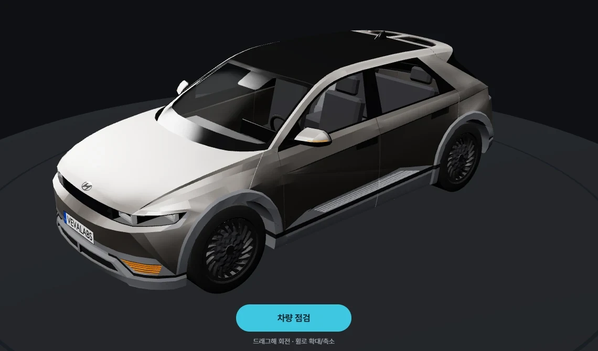

| 보닛을 열어 점검 부위 탐색 | 네 타이어의 개별 육안 기록 |
| --- | --- |
| [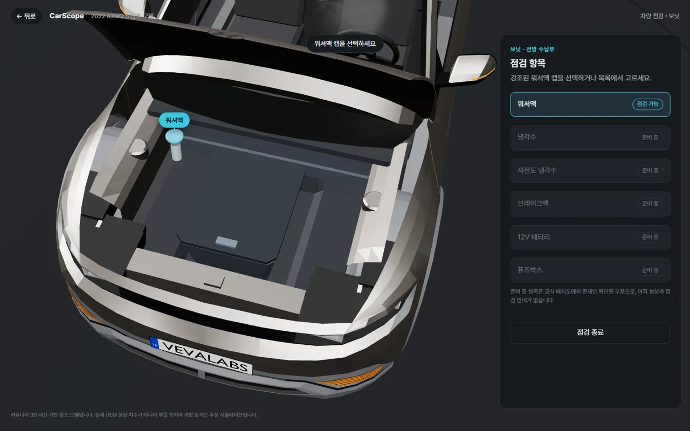](hood-open.webp) | [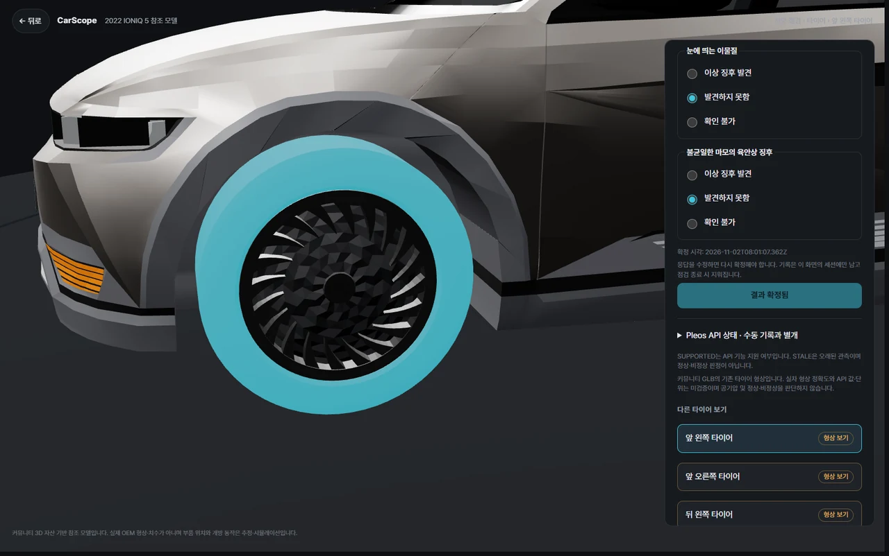](tire-inspection.webp) |
| 추정 전방 구획과 워셔액 위치 안내. 실제 OEM 힌지·정비 절차를 재현한 형상은 아닙니다. | 바퀴별 응답 → 확정·수정 → 요약. **USER_REPORTED**, 정상·안전 판정이 아닙니다. |

| EV 충전구 선택과 상태 분리 | 전면 와이퍼 선택과 상태 표시 |
| --- | --- |
| [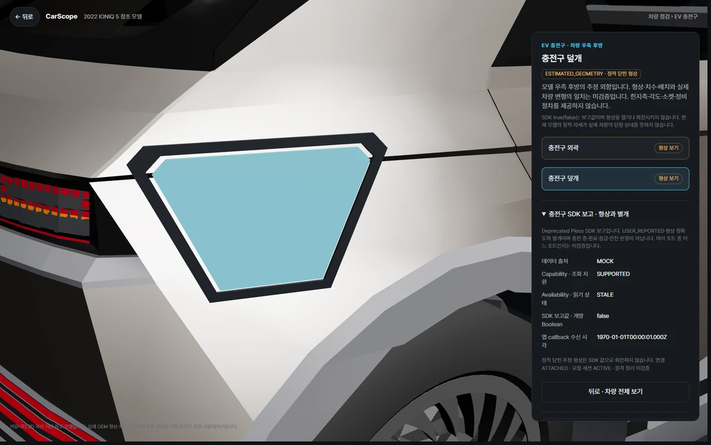](charge-port.webp) | [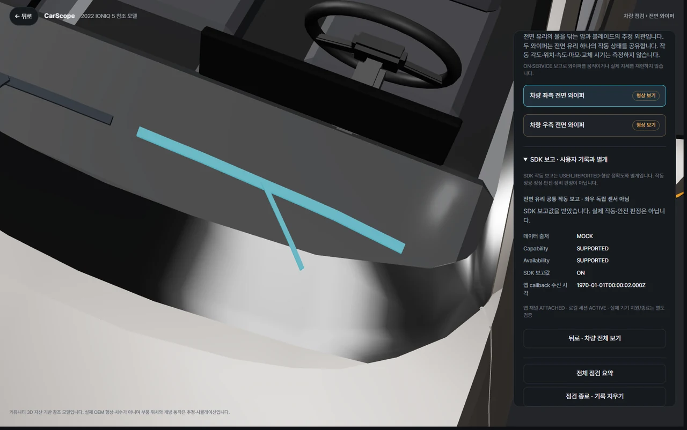](wiper-selection.webp) |
| 정적 닫힘 형상과 SDK 보고를 분리합니다. 충전구 위치·개방 각도·충전 가능 여부의 실측 증거가 아닙니다. | 선택·강조된 와이퍼는 정적 추정 형상입니다. 동작 상태를 블레이드 마모 판정으로 해석하지 않습니다. |

| 전조등 영역 선택과 전역 상태 | 모바일 카메라 보조와 결과 확정 |
| --- | --- |
| [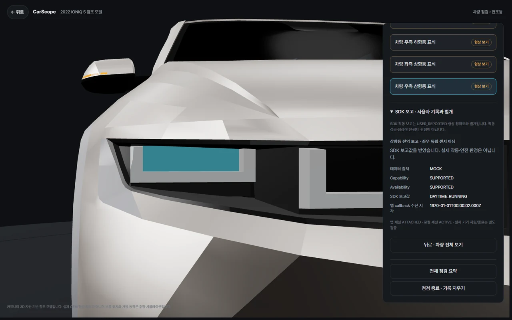](headlight-selection.webp) | [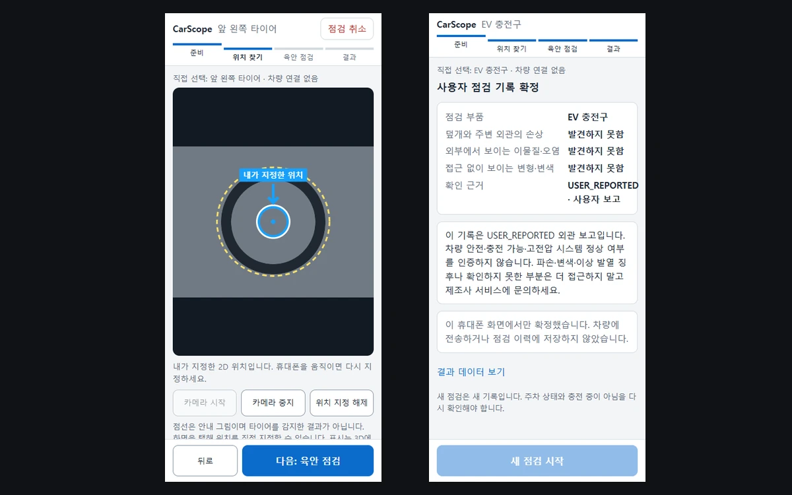](mobile-assistance.webp) |
| 기존 조명 메시를 재사용합니다. 전역 조명 보고는 좌·우 개별 센서값이나 실제 점등 효과가 아닙니다. | 기존 모바일 캡처 2장의 편집본. **수동 2D 표시**, 자동 객체 인식·공간 추적·정밀 측정은 없습니다. |

초기 P3-A4 워셔액 흐름 캡처 — 현재 추가된 타이어·요약 화면과 구분

| ① 차량 점검 · 보닛 강조 | ② 보닛 개방 · 점검 항목 |
| --- | --- |
| <a href="../p3-a4/flow-1-hood-highlight.webp">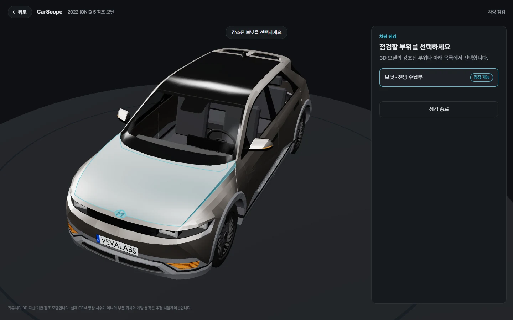</a> |  |
| 강조된 보닛을 3D에서 누르거나 목록에서 선택합니다. | 카메라가 전방으로 이동하고 보닛이 열립니다. 워셔액 캡만 선택할 수 있습니다. |

| ③ 워셔액 점검 상세 | ④ 스마트폰 연결 QR |
| --- | --- |
| <a href="../p3-a4/flow-3-washer-detail.webp">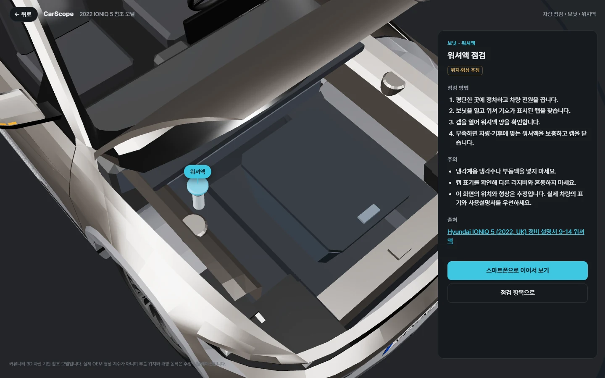</a> |  |
| 근접 카메라와 함께 점검 방법·주의사항·출처를 표시합니다. | QR을 스캔하면 모바일 카메라 보조 화면이 열립니다. |

위 4장은 1440×900 로컬 Chrome에서 `inspect.html`을 실제로 실행해 캡처했습니다(2026-11-01, main `062b6b2`와 같은 UI 코드). ③·④는 같은 화면의 일부를 잘라낸 것입니다. QR은 접근이 제한된 스테이징 주소를 가리킵니다. 마지막 모바일 보조 단계는 사용자가 실제 스마트폰에서 확인했지만 공개 가능한 실기기 화면 캡처가 없어 이미지를 넣지 않았습니다.

이전 단계의 엔지니어링 검증 이미지 (P2-A6)

| 3D 참조 모델 | 부품 선택 검증 | 외피 숨김 검증 |
| --- | --- | --- |
| 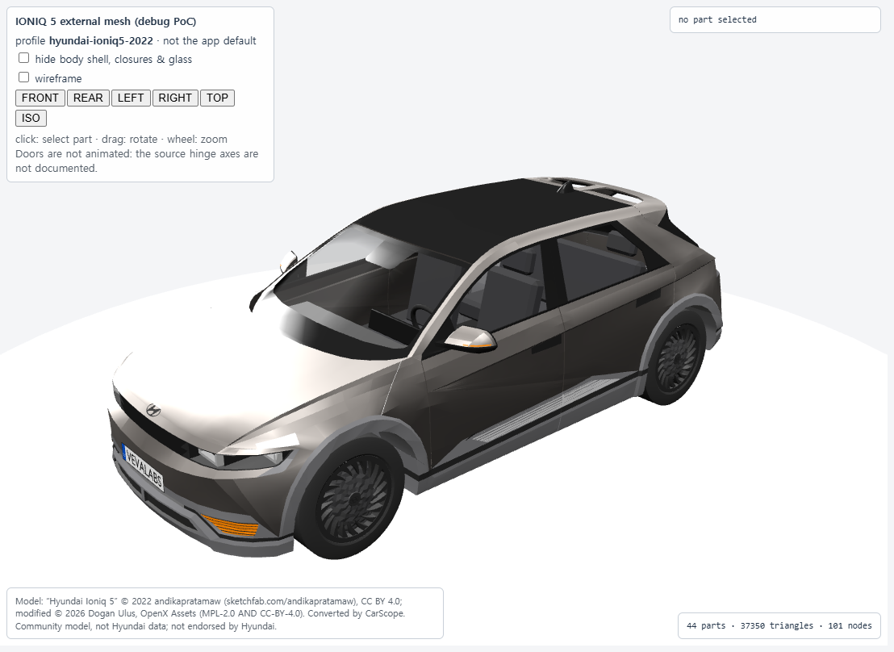 | 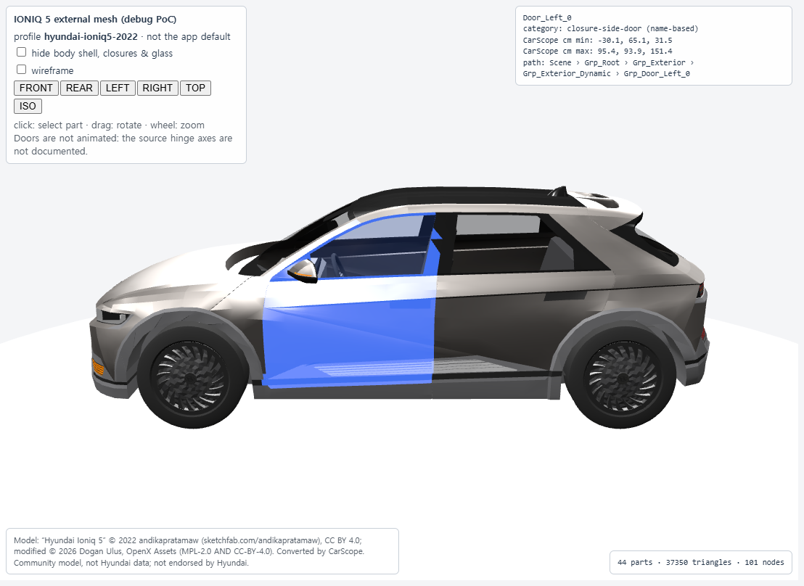 | 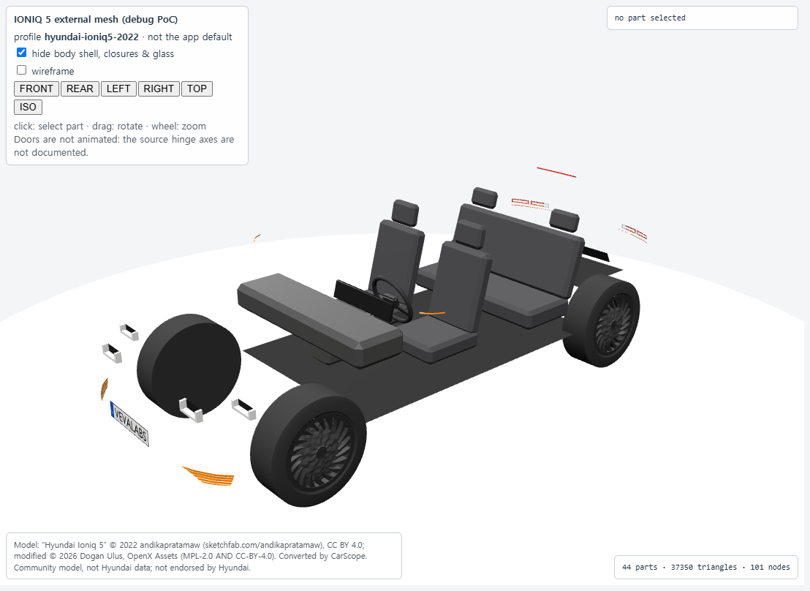 |

P2-A6 엔지니어링 PoC 캡처이며 현재 차량 점검 UI 화면이 아닙니다.

## 2026-11-02 선별 기록

기준 main `e9cb10901c21a0958c2c26a98c4c75ad26fde7f1`에서 기존 캡처만 선별했다. 새 촬영·앱 기능 개발·AVD·Android 빌드·GLB 변환은 실행하지 않았다. 원본 파일은 이동·변경하지 않았다. 이 폴더에는 사용자가 요청한 **선별·최적화 파생 이미지**만 보관하며 SDK/GLB/원본 로그·캡처를 복사하지 않는다.

### 선택한 화면

| WebP | 기존 원본 | 화면의 의미와 한계 |
|---|---|---|
| `hero-vehicle.webp` | 저장소 `docs/visuals/p3-a4/hero-home.webp` | 실제 Chrome의 3D 차량 홈. 기존 README Hero를 재사용 |
| `hood-open.webp` | 저장소 `docs/visuals/p3-a4/flow-2-hood-open-components.webp` | P3-A4 보닛 개방·워셔액 안내, 추정 형상·축 시뮬레이션 |
| `tire-inspection.webp` | 외부 `p4-a1/20261102-run02/browser-tire-inspection-1600/02-checklist-completed.png` | 차량 3D 타이어 선택과 USER_REPORTED 체크리스트. 실제 차량 진단 아님 |
| `charge-port.webp` | 외부 `p5-b1/charge-browser/00-static-geometry.png` | 정적 추정 충전구와 MOCK 상태 패널 |
| `wiper-selection.webp` | 외부 `p5-b1/browser-final/01-wiper-sdk-on.png` | 실제 UI의 와이퍼 선택/강조, 정적 추정 형상·MOCK 상태 |
| `headlight-selection.webp` | 외부 `p5-b1/browser-final/02-light-sdk-global.png` | 기존 조명 메시 선택과 전역 MOCK 상태. 좌우 센서/실제 점등 아님 |
| `mobile-assistance.webp` | 외부 `qr-ar-01/p5-a1/20261103-run02/tires/02-camera-marker.png` + `qr-ar-01/p5-a2/20261103-types-final/mobile/charge/01-confirmed.png` | 실제 구현 UI의 합성 타이어 카메라 수동 표시 + 충전구 확정. 두 캡처의 편집본이며 실제 폰·실물 인식 아님 |

외부 경로의 루트는 `C:/CarScope-External/`다. P5-B1은 PR #51로 main에 병합된 구현이며 작업 브랜치의 미병합 기능을 가져오지 않았다. 출처별 검증은 [P5-B1 증거](../../evidence/p5-b1/README.md), [P4-A1 제품 흐름](../../p4-a1-inspection-product-flow.md), [P5-A1 증거](../../evidence/p5-a1/README.md), [P5-A2 증거](../../evidence/p5-a2/README.md)를 따른다. 새 Runtime·실기기 결과로 전용하지 않는다.

### 변환과 재현

Pillow 12.0.0의 WebP encoder로 RGB 변환 후 원래 비율을 유지해 최대 1280×900으로 축소했다(확대 없음). 일반 캡처는 quality 88/method 6. Hero는 기존 WebP에서 같은 설정으로 재인코딩했다. 메타데이터(EXIF/XMP/ICC)는 복사하지 않았다.

모바일 편집본은 두 기존 캡처의 상단 390×844 영역을 각각 비율 유지 축소하여 1200×750 배경에 나란히 배치했다(quality 90/method 6). UI 요소를 그리거나 상태·문구·응답을 조작하지 않았다. 프레임 아래 긴 안내 일부는 잘렸으므로 README 캡션에 2D 수동 표시·합성 영상·미측정 한계를 명시한다. 원본의 실제 점검 상태를 바꾼 합성 화면이 아니다.

[manifest.json](manifest.json)에 입력 경로·SHA-256·원본 크기·crop 좌표·출력 크기·파일 크기·편집 방법을 기록했다. 독립 실행 소스가 없는 외부 캡처를 재촬영하지 않고 기존 입력을 확인할 수 있도록 했다.

### 민감정보·출처 검토

- 각 원본/출력 화면을 육안 검토했다. 새 선별 이미지에는 QR, invite/submit/receiver 토큰, 실제 VIN·GPS·개인 연락처·계정·개인 영상이 없다. 3D 차량의 `VEVALABS` 번호판 표시는 커뮤니티 모델의 텍스처이며 실제 사용자 차량 번호가 아니다.
- 상태 패널의 MOCK·관측 시각은 테스트 fixture다. 실차 데이터 또는 실제 기기 수신 성공으로 표시하지 않는다. 기존 README의 과거 QR 캡처는 이번 작업에서 수정하지 않았으며 새 갤러리에는 QR 화면을 넣지 않았다.
- 모델/상표는 기존 [출처 정책](../../p2-a6-ioniq5-asset.md)을 유지한다. 3D 6장: “Hyundai Ioniq 5” © 2022 [andikapratamaw](https://sketchfab.com/andikapratamaw), [CC BY 4.0](https://creativecommons.org/licenses/by/4.0/); OpenX Assets 수정 © 2026 Dogan Ulus (`MPL-2.0 AND CC-BY-4.0`). CarScope 변환·추정 Geometry·UI 렌더링·축소/WebP 변환을 표시한다. 원본 메시·GLB·Blender 파일은 배포하지 않는다.
- CarScope는 Hyundai와 무관한 프로토타입이다. 저작권 라이선스가 차량 디자인·상표 사용에 대한 공식 보증을 뜻하지 않는다는 기존 고지를 유지한다. 모바일 1장은 CarScope UI/자체 합성 입력만 포함하며 외부 3D 모델을 포함하지 않는다.

검증 범위는 WebP 디코딩/크기·출처 hash, 로컬 이미지 경로, README 기존 본문 보존, 화면 검토다. 기능 테스트·실기기/AVD·성능 실측은 새로 실행하지 않았다.

최종 확인: WebP 7장 총 **389,894 bytes(약 381 KiB)**, 입력 해시 8개 일치, README 이미지 참조 14개 모두 존재, EXIF/XMP/ICC 미포함. GitHub GFM API로 렌더링한 HTML을 로컬 GitHub 유사 CSS로 확인했다(실제 github.com 화면 캡처는 아님). Chrome 1100px/390px에서 깨진 이미지 0, 페이지 가로 넘침 없음. 외부 검토 산출물은 `C:/CarScope-External/readme-visuals/preview-results.json`, `readme-1100.png`, `readme-390.png`다. 기존 Features부터 Model/References 전까지의 기술·실행·검증·로드맵 본문은 원문과 동일하게 보존했다.
